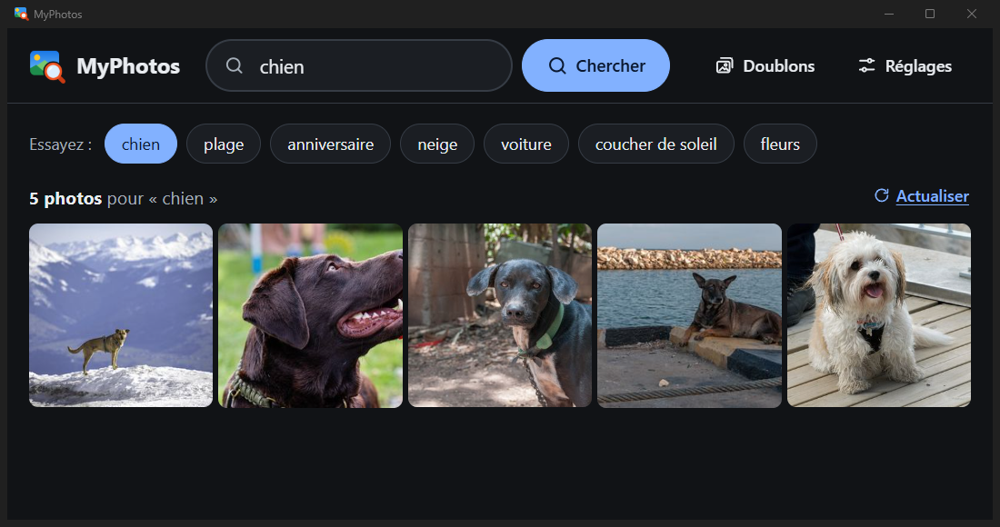
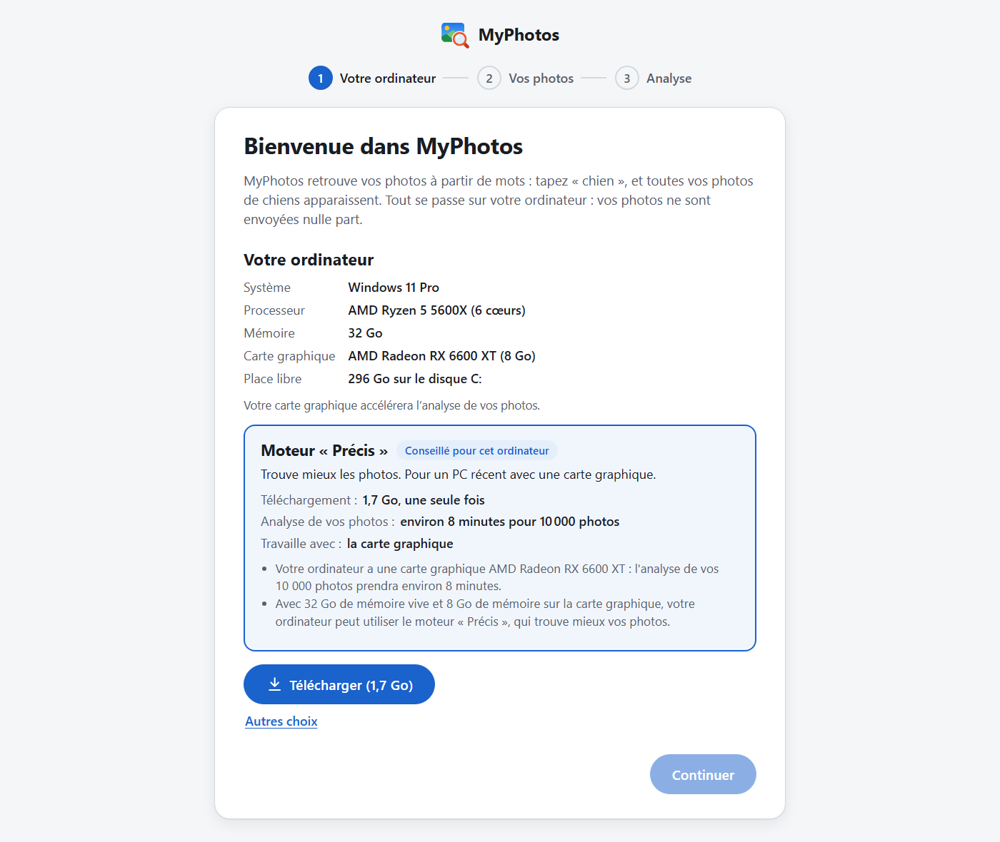
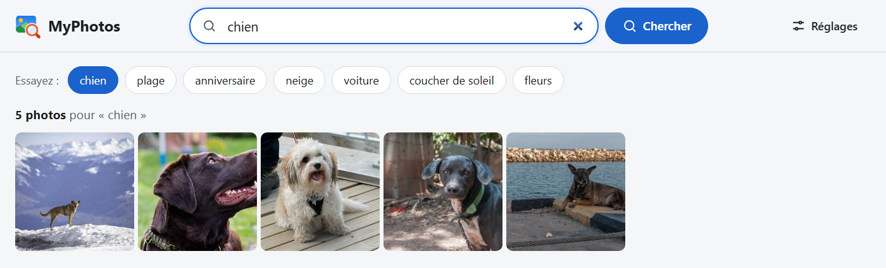
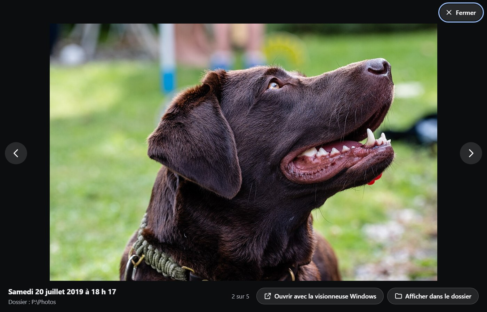

# MyPhotos

**Retrouvez vos photos en tapant ce qu'elles montrent.** Tapez « chien » : toutes vos photos de chiens apparaissent. MyPhotos fonctionne entièrement sur votre ordinateur Windows ; vos photos ne sont envoyées nulle part.



*English version below: [In English](#in-english).*

## À quoi sert MyPhotos ?

Vous avez des milliers de photos et vous ne retrouvez jamais celle du gâteau d'anniversaire ? MyPhotos regarde une fois chacune de vos photos pour reconnaître ce qu'elle montre. Ensuite, il suffit de décrire ce que vous cherchez, avec vos mots :

- « chien », « chat », « cheval » ;
- « plage », « neige », « coucher de soleil », « montagne » ;
- « gâteau d'anniversaire », « sapin de Noël », « pizza » ;
- « voiture », « vélo », « bateau » ;
- « chien sur la plage », « match de basket-ball » ;
- « capture d'écran », « chantier ».

Inutile d'avoir rangé, renommé ou étiqueté vos photos : MyPhotos comprend leur contenu, à la manière de Google Photos, mais sans rien envoyer sur Internet. Sans recherche, il affiche toutes vos photos, des plus récentes aux plus anciennes, mois par mois. Il permet aussi de cocher des photos pour les copier ou les mettre à la Corbeille, et de repérer vos photos en double ([Les doublons](#les-doublons)).

## Vos photos restent chez vous

- **Tout est local.** La reconnaissance et la recherche se font sur votre ordinateur, avec sa carte graphique ou son processeur. MyPhotos s'ouvre dans sa propre fenêtre, qui affiche une page servie par MyPhotos lui-même à une adresse locale (`http://127.0.0.1:7796`), inaccessible depuis Internet comme depuis les autres appareils de votre réseau. Depuis la 0.4.0, cette page demande en plus un secret tiré à chaque lancement : un autre compte Windows du même PC ne peut plus l'afficher, et taper son adresse dans un navigateur affiche seulement « Ouvrez MyPhotos depuis son raccourci ».
- **Aucun compte**, aucune inscription, aucune publicité, aucune télémétrie : MyPhotos ne collecte rien et n'envoie rien.
- **Un téléchargement au premier lancement** : le moteur de reconnaissance, depuis Hugging Face. C'est une version figée, dont chaque fichier est contrôlé par son empreinte SHA-256. Ensuite, MyPhotos n'a plus besoin d'Internet.
- **Les nouvelles versions, si vous le voulez.** Au premier lancement, MyPhotos vous demande s'il doit vous proposer ses nouvelles versions. Si vous acceptez, il demande une fois par jour au site GitHub, où il est publié, le numéro de la dernière version. Rien d'autre n'est envoyé : ni vos photos, ni vos recherches, ni aucun identifiant. Une nouvelle version ne s'installe que si vous cliquez sur **Mettre à jour**, et seulement si elle porte la signature du projet ([Les mises à jour](#les-mises-à-jour)).
- **Vos photos ne sont jamais modifiées.** MyPhotos ne les supprime que si vous le lui demandez, après confirmation, et alors vers la **Corbeille de Windows**, d'où vous pouvez les restaurer : jamais de suppression définitive (un disque sans Corbeille, comme une clé USB ou un disque réseau, est refusé). Ce qu'il retient de vos photos (miniatures, dates, description chiffrée de chaque photo) reste dans son propre dossier, sur votre ordinateur.

À savoir : le moteur tourne grâce à ONNX Runtime et DirectML, deux bibliothèques de Microsoft. Leurs versions officielles peuvent émettre des événements de diagnostic Windows, que Windows ne transmet à Microsoft que si vous l'y avez autorisé (Paramètres > Confidentialité et sécurité > Diagnostics et commentaires). Détails dans [THIRD_PARTY_NOTICES.md](THIRD_PARTY_NOTICES.md).

## Configuration requise

| | Minimum | Conseillé |
|---|---|---|
| Système | Windows 10 64 bits, version 1809 ou plus récente | Windows 11 |
| Mémoire vive | 4 Go (moteurs Rapide et Standard) | 8 Go ; 16 Go pour le moteur Précis |
| Carte graphique | facultative | compatible DirectX 12 ; 6 Go de mémoire pour le moteur Précis |
| Disque | le moteur (de 749 Mo à 2,1 Go), plus environ 35 Ko par photo | |
| Internet | une fois, pour télécharger le moteur | pour les nouvelles versions, si vous les acceptez |
| Affichage | WebView2 et .NET Framework 4.7.2, fournis avec Windows 11 et la plupart des Windows 10 | |

Sans carte graphique utilisable, le processeur fait tout le travail : c'est plus lent, mais cela fonctionne. Si WebView2 manque, MyPhotos s'ouvre dans Microsoft Edge en mode application, et à défaut dans votre navigateur (voir [Questions fréquentes](#myphotos-souvre-dans-edge-ou-dans-mon-navigateur)).

Formats reconnus : JPEG (`.jpg`, `.jpeg`, `.jfif`), PNG, WebP, BMP, GIF et TIFF. Pas encore : HEIC (iPhone), vidéos, formats RAW. Les images de moins de 96 pixels de côté (icônes, émojis) sont ignorées.

## Installation

**Avec l'installateur (conseillé).**

1. Téléchargez **MyPhotos-<version>-installation.exe** (environ 40 Mo) depuis la page [Releases](https://github.com/glenac/MyPhotos/releases) du projet.
2. Double-cliquez dessus. Laissez cochée (ou décochez) **Mettre une icône MyPhotos sur le Bureau**, puis cliquez sur **Installer**. MyPhotos s'installe pour vous seul, sans droits d'administrateur, dans `%LOCALAPPDATA%\Programs\MyPhotos`, avec un raccourci dans le menu Démarrer.
3. Laissez cochée **Lancer MyPhotos**, puis cliquez sur **Terminer**.

La version installée démarre environ trois fois plus vite que MyPhotos.exe seul (environ 0,5 s au lieu de 1,6 s sur le PC d'essai) : elle n'a pas à se décompresser à chaque lancement. Pour passer à une nouvelle version, lancez simplement son installateur : il remplace l'ancienne et garde vos données. Si MyPhotos est ouvert, l'installateur vous demande de le fermer.

**Sans installation.** **MyPhotos.exe** (un seul fichier d'environ 50 Mo) reste publié, ainsi que l'archive **MyPhotos-<version>-windows.zip** (le même MyPhotos.exe, avec le mode d'emploi et les licences des composants). Rangez MyPhotos.exe où vous voulez, par exemple dans vos Documents, puis double-cliquez dessus : il n'y a rien à installer.

**Avertissement de Windows.** Au premier lancement, Windows peut afficher « Windows a protégé votre ordinateur » (Microsoft Defender SmartScreen), pour l'installateur comme pour MyPhotos.exe. Ce message apparaît pour les logiciels récents qui n'ont pas de signature numérique payante, ce qui est le cas de MyPhotos. Cliquez sur **Informations complémentaires**, puis sur **Exécuter quand même**.

## Premier lancement

MyPhotos s'ouvre dans sa propre fenêtre, comme un logiciel ordinaire, et vous guide en trois étapes : **Votre ordinateur**, **Vos photos**, **Analyse**.



1. **Votre ordinateur.** MyPhotos examine votre PC (système, processeur, mémoire, carte graphique, place libre) et vous conseille un moteur de reconnaissance, marqué « Conseillé pour cet ordinateur ». Il annonce la taille du téléchargement, la durée prévue de l'analyse et ce qui fera le travail : « la carte graphique » ou « le processeur ». Cliquez sur **Télécharger** (la taille est indiquée sur le bouton), ou sur **Autres choix** pour prendre un autre moteur. Dès que le téléchargement a commencé, vous pouvez cliquer sur **Continuer** : il se poursuit pendant que vous choisissez vos photos.
2. **Vos photos.** Choisissez les dossiers où se trouvent vos photos. MyPhotos propose votre dossier **Images** (et **Images de OneDrive** s'il existe), avec le nombre approximatif de photos qu'il contient : cliquez sur **Ajouter**. Pour un autre dossier, un disque externe par exemple, cliquez sur **Ajouter un dossier…**, ou tapez son emplacement sous « Ou tapez l'emplacement du dossier ». Avant d'ajouter un dossier, MyPhotos compte en quelques secondes les photos de ses plus gros sous-dossiers et les présente dans une liste à cocher. Les dossiers de **captures d'écran** et de **fonds d'écran** (« Captures d'écran », « Screenshots », « Wallpapers », « Fonds d'écran »…) sont décochés d'office, avec la raison ; tout le reste est coché. Décochez ce qui ne contient pas vos photos, puis cliquez sur **Ajouter ce dossier** : les sous-dossiers décochés sont exclus (voir les Réglages), et rien n'est supprimé de votre ordinateur. Les dossiers retenus apparaissent sous « Dossiers choisis ». Cliquez ensuite sur **Continuer**.
3. **Analyse.** MyPhotos regarde chacune de vos photos une seule fois, en commençant par les plus récentes. Une barre de progression indique où il en est et le temps restant. Sous « Nouvelles versions de MyPhotos », répondez **Oui, me la proposer** ou **Non merci** ([Les mises à jour](#les-mises-à-jour)). Vous pouvez cliquer tout de suite sur **Commencer à chercher** : les résultats s'enrichissent au fur et à mesure.

L'analyse continue en arrière-plan. Le bandeau en haut de la page permet de la mettre en **Pause** puis de la **Reprendre**. Si vous arrêtez MyPhotos, elle reprendra où elle en était au lancement suivant.

## Chercher dans vos photos

- Tapez ce que vous cherchez dans la barre « Que cherchez-vous ? », puis appuyez sur Entrée ou cliquez sur **Chercher**. Les boutons « Essayez : » proposent des exemples. La touche `/` place le curseur dans la barre de recherche.
- Les photos **sûres** s'affichent en premier. En dessous, la rubrique **Moins sûres** regroupe les photos qui « correspondent peut-être à votre recherche ».
- Peu de résultats ? Le bouton **Voir les photos les plus proches** montre, 60 par 60, celles qui s'approchent le plus de votre recherche, dans la rubrique **Moins probables**.
- Cliquez sur une photo pour l'ouvrir dans la **visionneuse**.





Dans la visionneuse, les flèches (à l'écran, ou ← et → au clavier) passent d'une photo à l'autre. En bas s'affichent la date de la photo et son dossier. **Ouvrir avec la visionneuse Windows** ouvre la photo dans le logiciel habituel de Windows, **Afficher dans le dossier** ouvre l'Explorateur sur la photo, et **Fermer** (ou la touche Échap) ramène aux résultats. **Copier**, **Copier dans un dossier…** et **Supprimer** agissent sur la photo affichée (voir ci-dessous).

Le bouton **Réglages**, en haut à droite, regroupe :

- **Vos dossiers de photos** : ajouter un dossier (**Ajouter un dossier…**) ou en retirer un (**Retirer**). Retirer un dossier ne supprime aucune photo : MyPhotos cesse simplement de s'en occuper. **Exclure un sous-dossier…** ouvre la fenêtre « Choisir un dossier » dans ce dossier. Le sous-dossier choisi (captures d'écran, fonds d'écran…) n'est plus regardé, et ses photos disparaissent de MyPhotos sans être supprimées de l'ordinateur. Un dossier situé ailleurs est refusé. Les sous-dossiers exclus sont listés sous leur dossier ; **Ne plus exclure** les fait revenir.
- **Analyse des photos** : MyPhotos repère seul les photos ajoutées, modifiées ou supprimées, à chaque démarrage puis toutes les heures. **Actualiser**, ici ou au-dessus des photos, refait tout de suite le tour de tous vos dossiers. Les nouvelles photos sont ajoutées puis analysées, et celles qui ne sont plus sur le disque sont oubliées. Un dossier inaccessible (disque débranché) garde ses photos. À la fin, MyPhotos dit ce qui a changé, par exemple « 3 nouvelles photos, 5 012 photos retirées ». La recherche reste possible pendant ce temps.
- **Moteur de reconnaissance** : le moteur utilisé, et le bouton **Changer de moteur**.
- **Votre ordinateur** : ce que MyPhotos sait de votre PC.
- **Raccourci** (MyPhotos.exe seul) : **Créer un raccourci sur le Bureau et dans le menu Démarrer**. La version installée a déjà le sien.
- **Arrêter MyPhotos**.

**Fermer la fenêtre arrête MyPhotos.** Si un travail est en cours (analyse, copie, recherche des doublons, téléchargement du moteur), MyPhotos demande d'abord s'il faut vraiment l'arrêter ; l'analyse reprendra au lancement suivant. Un double-clic sur MyPhotos alors qu'il est déjà ouvert ramène simplement sa fenêtre au premier plan. MyPhotos retient la place et la taille de sa fenêtre d'une fois sur l'autre.

## Choisir, copier, supprimer

Comme dans Google Photos, vous pouvez cocher des photos pour agir sur plusieurs à la fois :

- au survol d'une miniature, un rond apparaît en haut à gauche : cliquez dessus pour cocher la photo (sur un écran tactile, faites un appui long) ;
- dès qu'une photo est cochée, un clic sur une miniature la coche ou la décoche, et Maj+clic coche toute une suite ; le rond à côté d'un mois coche tout le mois ;
- Ctrl+A coche tout ce qui est affiché, Échap annule la sélection.

Une barre remplace alors l'en-tête. Elle indique le nombre de photos cochées et propose :

- **Copier** (Ctrl+C) : les photos vont dans le presse-papiers de Windows ; collez-les avec Ctrl+V dans un dossier, un e-mail, un document ;
- **Copier dans un dossier…** : une fenêtre de Windows demande où les copier. Rien n'est jamais écrasé : une photo dont le nom est déjà pris est copiée sous le nom « photo (2).jpg ». Les dates sont gardées, et une copie interrompue ne laisse aucun fichier à moitié écrit ;
- **Supprimer** (Suppr) : après confirmation, les photos partent dans la **Corbeille de Windows**, d'où vous pouvez les restaurer tant qu'elle n'est pas vidée. MyPhotos ne supprime jamais définitivement : sur un disque sans Corbeille (clé USB, disque réseau), il refuse. Il refuse aussi une photo qui a changé depuis son analyse.

La visionneuse propose les mêmes actions pour la photo affichée.

## Les doublons


Le bouton **Doublons**, en haut à droite, ouvre l'écran des photos en double. Cliquez sur **Chercher les doublons** : MyPhotos compare vos photos entre elles, sur votre ordinateur, et vous pouvez continuer à chercher pendant ce temps. Il les range en trois rubriques :

- **Copies identiques** : le même fichier, enregistré plusieurs fois ;
- **Copies retouchées** : la même photo, réduite, recompressée (envoyée par WhatsApp…), légèrement recadrée ou redressée, convertie en PNG, éclaircie ou assombrie, ou entourée d'une bordure ;
- **Photos très proches (rafales)** : plusieurs prises du même instant. Cette rubrique est repliée et rien n'y est coché : à vous de choisir.

Chaque photo s'affiche avec sa définition, sa taille, sa date et son dossier. Dans chaque groupe, MyPhotos indique la photo **À garder** (la plus grande ; à définition égale, l'original plutôt qu'une copie évidente comme « IMG_0001 - Copie.jpg », puis le fichier le plus détaillé) et coche les autres. Vérifiez, cochez ou décochez (un clic sur une miniature l'ouvre en grand), puis cliquez sur **Supprimer les copies cochées** : le bouton indique la place qu'elles occupent. Après confirmation, elles partent dans la Corbeille de Windows ; la place est libérée quand vous la videz. MyPhotos refuse de mettre à la Corbeille toutes les photos d'un groupe de copies : il ne vous en resterait aucune.

La première recherche prend un peu de temps : environ 40 secondes pour 10 000 photos sur le PC d'essai, avec une photothèque riche en rafales. MyPhotos garde ce qu'il a déjà comparé : les recherches suivantes ne prennent que quelques secondes. Quand l'analyse ajoute des photos, ou quand vous en supprimez, la liste se met à jour d'elle-même. Les photos pas encore analysées ne sont comparées qu'à l'identique. Limites : une photo retournée en miroir, tournée d'un quart de tour ou très recadrée n'est pas reconnue comme une copie. Détails et mesures : [outils/DOUBLONS.md](outils/DOUBLONS.md).

## Le moteur de reconnaissance

MyPhotos propose quatre moteurs, tous tirés de **SigLIP 2**, un modèle de Google publié sous licence libre Apache-2.0, dans les exports ONNX d'onnx-community, en demi-précision (fp16). Un moteur plus précis trouve mieux vos photos, mais il est plus long à télécharger et à faire travailler.

| Moteur | Téléchargement¹ | Carte graphique² | Processeur² | Rappel en français³ | Pour qui ? |
|---|---:|---:|---:|---:|---|
| Rapide | 752 Mo | 310 photos/s | 26 photos/s | 80,2 % | PC ancien ou sans carte graphique |
| Standard | 749 Mo | 92 photos/s | 7 photos/s | 82,9 % | tous les PC |
| Précis | 1,7 Go | 20 photos/s | 1,5 photo/s | 85,0 % | PC récent avec une carte graphique |
| Très précis | 2,1 Go | 15 photos/s | 1,3 photo/s | 85,7 % | PC puissant avec une bonne carte graphique |

¹ Tailles affichées par MyPhotos, qui compte comme l'Explorateur de Windows (1 Go = 1 024 Mo). En millions d'octets : 789, 785, 1 798 et 2 307.

² Débit du moteur seul, mesuré sur un processeur Ryzen 5 5600X et une carte Radeon RX 6600 XT. Lors d'une première lecture, un disque dur ordinaire limite l'analyse à environ 10 photos par seconde.

³ Banc d'essai multilingue publié par le projet Immich (jeu Crossmodal-3600), recherches en français.

**Le moteur conseillé.** MyPhotos choisit selon votre matériel :

- carte graphique DirectX 12 dédiée d'au moins 6 Go et 16 Go de mémoire vive : **Précis**, si l'analyse de vos photos prend moins d'une demi-heure, sinon **Standard** ;
- autre carte graphique utilisable (petite carte, puce graphique intégrée récente) : **Standard** ;
- pas de carte graphique utilisable : **Standard** avec au moins 6 cœurs et 8 Go de mémoire vive, sinon **Rapide**.

Il vérifie ensuite que la mémoire et la place libre suffisent. **Très précis** n'est jamais conseillé d'office : il ne gagne que 0,7 point sur Précis, pour un téléchargement plus lourd. Il reste proposé sous « Autres choix ».

**La qualité des résultats.** Sur un jeu d'essai de 306 images publiques réparties en 24 catégories, 93 à 94 % des photos « sûres » sont de bonnes réponses, selon le moteur ; elles représentent 68 à 75 % de toutes les bonnes réponses. En comptant les « moins sûres », 84 à 90 % des bonnes réponses sont trouvées. Les détails sont dans [outils/EVALUATION.md](outils/EVALUATION.md).

**Changer de moteur.** Dans les Réglages, cliquez sur **Changer de moteur** : la fenêtre « Changer de moteur de reconnaissance » présente les quatre moteurs. Cliquez sur **Choisir ce moteur**, puis confirmez. MyPhotos télécharge le moteur s'il n'est pas déjà sur l'ordinateur, puis analyse de nouveau toutes vos photos. Pendant ce temps, vous pouvez continuer à chercher, mais les résultats restent incomplets jusqu'à la fin de l'analyse.

**Sans Internet.** Pour un PC hors ligne, posez à côté de MyPhotos.exe un dossier `modele` qui contient le moteur, rangé comme MyPhotos le range lui-même : le plus simple est de copier le dossier `%LOCALAPPDATA%\MyPhotos\modele` d'un PC où le moteur a déjà été téléchargé. Quand vous cliquez sur **Télécharger**, MyPhotos recopie ce dossier au lieu de passer par Internet, après avoir contrôlé la taille et l'empreinte SHA-256 de chaque fichier. Les sous-dossiers s'appellent `rapide`, `base` (Standard), `precis` et `tres_precis`.

## Les mises à jour

Depuis la 0.4.0, MyPhotos peut vous proposer ses nouvelles versions et s'installer lui-même, en un clic. Il ne le fait qu'avec votre accord : la question est posée à l'étape **Analyse** du premier lancement ou, si vous venez d'une version plus ancienne, dans un bandeau en haut de la page. Pour changer d'avis : **Réglages**, section « Nouvelles versions », case **Me proposer les nouvelles versions de MyPhotos**. Le bouton **Rechercher une nouvelle version** vérifie tout de suite, même si la case est décochée.

**Quand une nouvelle version sort**, un bandeau l'annonce en haut de la page :

- **Mettre à jour** : MyPhotos résume les nouveautés et demande confirmation. Il télécharge la nouvelle version (environ 40 Mo ; une barre montre l'avancement, et **Annuler** l'arrête), la contrôle, se ferme, l'installe (une petite fenêtre d'avancement s'affiche) puis se rouvre tout seul. Vos photos, leur analyse, le moteur et vos réglages sont gardés, et une analyse en cours reprend où elle en était. Au lancement suivant, un bandeau confirme la nouvelle version, ou dit que la mise à jour n'a pas abouti : rien n'a changé alors.
- **Nouveautés** ouvre la page de la version dans votre navigateur.
- **Plus tard** cache le bandeau jusqu'au lendemain. La mise à jour reste proposée dans les Réglages.

Une copie de photos en cours doit d'abord se terminer. **MyPhotos.exe seul** (sans installation) ne se met pas à jour lui-même : son bandeau propose **Télécharger**, qui ouvre la page de la nouvelle version.

**Ce qui est envoyé.** Une fois par jour au plus, MyPhotos lit le petit fichier `MyPhotos-mise-a-jour.json` de la dernière version publiée sur GitHub, en HTTPS. Comme pour toute visite d'un site, GitHub voit l'adresse IP de votre connexion ; MyPhotos n'envoie ni vos photos, ni vos recherches, ni identifiant, ni même son numéro de version. L'installateur n'est téléchargé que lorsque vous cliquez sur **Mettre à jour**.

**Sécurité.** Ce fichier est signé avec une clé qui reste sur l'ordinateur du projet, jamais sur GitHub, et MyPhotos contient de quoi vérifier cette signature : un fichier non signé, abîmé ou modifié est ignoré. Même un compte GitHub volé ne suffirait donc pas à envoyer un faux MyPhotos. Le fichier donne la taille et l'empreinte SHA-256 exactes de l'installateur, contrôlées après le téléchargement, puis encore une fois juste avant l'installation. MyPhotos ne propose jamais de revenir à une version plus ancienne.

**Depuis la 0.3.0 ou plus ancienne**, installez la 0.4.0 à la main, une dernière fois, avec `MyPhotos-0.4.0-installation.exe` : vos données sont gardées. Les versions suivantes se proposeront d'elles-mêmes.

## Questions fréquentes

### Où sont mes données ?

Dans le dossier `%LOCALAPPDATA%\MyPhotos` (copiez ce chemin dans la barre d'adresse de l'Explorateur) :

- `index.db` : vos dossiers, ce que MyPhotos sait de chaque photo (date, dimensions, position GPS si l'appareil l'a enregistrée, description chiffrée calculée par le moteur) et les empreintes qui servent à repérer les doublons ;
- `miniatures.db` : les miniatures affichées dans les résultats ;
- `modele\` : le ou les moteurs téléchargés ;
- `journal.log` : le journal de fonctionnement, utile en cas de problème ;
- `jeton` : le secret qui protège la page de MyPhotos, tiré de nouveau à chaque lancement (à ne pas partager ; il ne sert plus une fois MyPhotos arrêté) ;
- `mises-a-jour\` : l'installateur d'une nouvelle version téléchargée par **Mettre à jour**, effacé une fois la nouvelle version installée ;
- `fenetre.json` : la place et la taille de la fenêtre ; `webview2\` : les fichiers de travail de la fenêtre, effacés à sa fermeture ; `edge\` : ceux d'Edge, seulement si MyPhotos a dû s'ouvrir dans Edge.

MyPhotos n'écrit rien dans vos dossiers de photos, sauf les copies que vous lui demandez (**Copier dans un dossier…**). À chaque lancement, MyPhotos.exe seul se décompresse aussi dans un dossier temporaire (`%TEMP%\_MEI…`), effacé à l'arrêt ; la version installée, déjà décompressée, n'en a pas besoin.

### MyPhotos s'ouvre dans Edge ou dans mon navigateur

Pour s'afficher dans sa propre fenêtre, MyPhotos utilise **WebView2**, le moteur d'affichage de Microsoft Edge, fourni avec Windows 11 et la plupart des Windows 10, ainsi que le .NET Framework 4.7.2 ou plus récent. S'ils manquent, MyPhotos s'ouvre dans **Microsoft Edge en mode application** (une fenêtre sans barre d'adresse), et à défaut dans votre navigateur. Tout fonctionne de la même façon. Fermer la fenêtre d'Edge arrête MyPhotos ; dans un navigateur, MyPhotos s'arrête tout seul environ trois minutes après la fermeture de sa page. Pour retrouver la fenêtre de MyPhotos, installez le « Runtime WebView2 » depuis le site de Microsoft, ou faites les mises à jour de Windows.

### Comment désinstaller MyPhotos ?

**Version installée.** Fermez MyPhotos, puis ouvrez **Paramètres** > **Applications** > **Applications installées** (sous Windows 10 : **Applications et fonctionnalités**), cherchez **MyPhotos** et choisissez **Désinstaller**. Une fois le programme retiré, une question s'affiche : « Supprimer aussi l'analyse de vos photos et le moteur téléchargé ? », avec la place qu'ils occupent.

- **Non** (le choix proposé) garde l'analyse et le moteur dans `%LOCALAPPDATA%\MyPhotos` : si vous réinstallez MyPhotos, il retrouve tout sans rien refaire.
- **Oui** les supprime. Seuls les fichiers créés par MyPhotos sont effacés ; un fichier que vous auriez rangé dans ce dossier est gardé, et le dossier avec.

Vos photos ne sont jamais touchées. Les raccourcis de MyPhotos (Bureau, menu Démarrer) sont retirés, y compris ceux créés depuis les Réglages s'ils désignent la version désinstallée.

**Sans installation (MyPhotos.exe seul).**

1. Fermez MyPhotos (dans les Réglages : **Arrêter MyPhotos**).
2. Supprimez MyPhotos.exe.
3. Supprimez le dossier `%LOCALAPPDATA%\MyPhotos`.

MyPhotos n'installe ni service ni démarrage automatique. MyPhotos.exe seul n'écrit rien dans le registre ; la version installée y ajoute seulement son entrée dans « Applications installées », retirée à la désinstallation. Vos photos restent intactes.

### Installer sans questions, sur plusieurs PC

L'installateur accepte les options habituelles d'Inno Setup. Il installe toujours pour le compte qui le lance : lancé « en tant qu'administrateur » avec un autre compte, il installerait MyPhotos pour cet autre compte.

```bat
rem Installation silencieuse, avec une icône sur le Bureau et un raccourci dans le menu Démarrer.
rem Sans icône sur le Bureau, ajouter /MERGETASKS="!desktopicon" ; sans raccourci dans le menu Démarrer, /NOICONS.
rem Autre dossier, /DIR="D:\Programmes\MyPhotos" ; journal, /LOG="C:\chemin\installation.log".
MyPhotos-<version>-installation.exe /VERYSILENT /SUPPRESSMSGBOXES /NORESTART

rem Désinstallation silencieuse, qui garde l'analyse des photos et le moteur...
"%LOCALAPPDATA%\Programs\MyPhotos\unins000.exe" /VERYSILENT /SUPPRESSMSGBOXES /NORESTART
rem ... ou qui les supprime aussi (seuls les fichiers créés par MyPhotos).
"%LOCALAPPDATA%\Programs\MyPhotos\unins000.exe" /VERYSILENT /SUPPRESSMSGBOXES /NORESTART /SUPPRIMERDONNEES
```

Codes de sortie : `0` fait ; `1` MyPhotos est ouvert, rien n'a été touché ; `7` dossier refusé (il contient un autre programme, ou son chemin est trop long). Passez toujours `/NORESTART` : sans lui, une installation silencieuse peut redémarrer Windows si un redémarrage est nécessaire.

### Mes photos sont-elles modifiées ?

Non. MyPhotos ne modifie jamais vos photos : il ne les déplace pas et ne les renomme pas. Il ne les supprime que si vous le lui demandez (**Supprimer**, ou **Supprimer les copies cochées** dans l'écran Doublons), après confirmation, et alors vers la Corbeille de Windows, jamais définitivement. Retirer un dossier de MyPhotos ne supprime aucune photo.

### J'ai supprimé une photo par erreur.

Ouvrez la Corbeille de Windows (icône du Bureau), faites un clic droit sur la photo, puis **Restaurer** : elle retrouve sa place. MyPhotos la retrouve à son prochain passage, ou tout de suite avec **Actualiser**.

### J'ai supprimé des photos (ou tout un dossier), mais MyPhotos les montre encore.

Cliquez sur **Actualiser**, au-dessus des photos ou dans les Réglages : MyPhotos refait le tour de vos dossiers et oublie les photos qui ne sont plus sur le disque. Une photo que vous ouvrez alors que son fichier a disparu est aussi retirée tout de suite (« Cette photo n'existe plus sur le disque : MyPhotos l'a retirée. »). Si son disque est seulement débranché, MyPhotos ne retire rien.

### Mon dossier Images contient des captures d'écran ou des fonds d'écran.

Dans les Réglages, sous le dossier, cliquez sur **Exclure un sous-dossier…** et choisissez le dossier des captures : ses images disparaissent de MyPhotos, sans être supprimées de l'ordinateur. Au premier lancement, MyPhotos les décoche d'office.

### Puis-je chercher avec plusieurs mots ?

Oui, et c'est souvent plus efficace : décrivez la scène, par exemple « chien sur la plage » ou « gâteau d'anniversaire ». MyPhotos comprend la phrase entière ; il n'y a pas d'opérateurs ET ou OU à connaître. Sur le jeu d'essai, « chien sur la plage » trouve les 12 photos de chiens sur une plage, toutes classées « sûres », alors que « chien » seul les mêle à toutes les autres photos de chiens. Majuscules, pluriels et accents ne changent presque rien : « Chiens » ou « gateau » fonctionnent aussi.

### Dans quelle langue taper mes recherches ?

En français de préférence : c'est la langue de référence de MyPhotos, et ses seuils ont été réglés avec des recherches en français. SigLIP 2 est un modèle multilingue : l'anglais donne des résultats comparables sur le jeu d'essai, et d'autres langues fonctionnent aussi, sans avoir été mesurées ici. Évitez les mots à double sens : « basket » seul désigne aussi des chaussures, « basket-ball » est plus sûr.

### Que veut dire « Moins sûres » ?

Pour chaque photo, le moteur estime la probabilité qu'elle corresponde à votre recherche. Au-dessus d'un premier seuil, la photo est « sûre » ; un peu en dessous, elle est rangée dans « Moins sûres ». Les deux seuils ont été réglés pour chaque moteur sur le jeu d'essai.

### Mes photos sont sur un disque externe ou sur le réseau.

Ajoutez le dossier comme les autres. Si le disque est débranché ou le dossier injoignable, MyPhotos garde ce qu'il en sait et reprend quand le dossier revient. Depuis la 0.4.0, il reconnaît aussi le disque lui-même (son numéro de série) : si un autre disque prend la même lettre, par exemple deux disques USB qui échangent leurs lettres, le dossier est simplement traité comme débranché, et rien n'est oublié. Un disque recopié ou cloné, qui porte les mêmes photos aux mêmes endroits, est reconnu et repris tel quel.

## Développement

Il faut Windows 64 bits et Python 3.14.

```powershell
python -m venv .venv
.venv\Scripts\python -m pip install -r requirements.txt
.venv\Scripts\python -m myphotos
```

`python -m myphotos` (ou `python lancer.py`, le point d'entrée de l'exécutable) lance le serveur local puis ouvre la fenêtre de MyPhotos (pywebview et WebView2). Depuis les sources, les données vont dans `donnees\`, ignoré par git ; MyPhotos.exe les range dans `%LOCALAPPDATA%\MyPhotos`.

| Variable d'environnement | Effet |
|---|---|
| `MYPHOTOS_DOSSIER` | dossier des données (index, miniatures, journal) |
| `MYPHOTOS_MODELES` | dossier des moteurs, pour réutiliser un moteur déjà téléchargé |
| `MYPHOTOS_PORT` | port local (7796 par défaut) |
| `MYPHOTOS_SANS_PAGE=1` | n'ouvre ni fenêtre ni page (essais) |
| `MYPHOTOS_NAVIGATEUR=1` (ou l'option `--navigateur`) | ouvre la page dans le navigateur, comme avant la 0.3.0, au lieu de la fenêtre |
| `MYPHOTOS_DEBUG=1` | outils de développement de la fenêtre (depuis les sources ; MyPhotos.exe demande en plus l'option `--essai-debogage`) |
| `MYPHOTOS_INACTIVITE_S` | dans le navigateur, délai d'arrêt automatique sans page ouverte (180 s par défaut) |
| `MYPHOTOS_TELECHARGEMENT_FACTICE=1` | simule le téléchargement du moteur, pour essayer l'interface |
| `MYPHOTOS_ESSAI_MANIFESTE`, `MYPHOTOS_ESSAI_CLE_MAJ` | avec `MYPHOTOS_TELECHARGEMENT_FACTICE=1` seulement : manifeste de mise à jour lu dans ce fichier local et vérifié avec cette clé publique d'essai (base64) ; téléchargement et installation simulés |

L'API locale n'accepte les requêtes POST qu'avec l'en-tête `X-MyPhotos: 1` (protection contre les autres sites ouverts dans le navigateur). `POST /api/quitter` arrête proprement le serveur.

**Tests** (292 essais) :

```powershell
.venv\Scripts\python.exe -m unittest tests.test_coeur tests.test_materiel tests.test_serveur tests.test_verifier_publication tests.test_doublons tests.test_construction tests.test_fenetre
```

`test_coeur` travaille avec un moteur factice et des images générées. `test_serveur` lance un vrai serveur sur un port d'essai et réutilise les moteurs déjà téléchargés (`donnees\modele`, ou `MYPHOTOS_MODELES`) ; son essai de bout en bout demande un dossier d'images publiques (`MYPHOTOS_ESSAI_PHOTOS`). `test_doublons` essaie la recherche des doublons sur des images générées. `test_construction` essaie, sans réseau, la préparation de la publication (`construire.py --paquet`, `--dossier`, `--installateur`) et les règles de l'installateur (`construction/MyPhotos.iss`) ; son essai réel (compilation, installation dans un dossier d'essai, mise à jour, désinstallations) ne tourne qu'à la demande (`MYPHOTOS_ESSAI_INSTALLATEUR=1`). `test_fenetre` essaie la fenêtre et ses replis (Edge, navigateur), la relance et la fermeture ; ses essais réels, sur un bureau Windows invisible et pilotés par le protocole DevTools, ne tournent qu'à la demande (`MYPHOTOS_ESSAI_FENETRE=1`). Le presse-papiers, la fenêtre « Choisir un dossier » et la Corbeille sont simulés ; leurs vrais appels à Windows ne sont essayés qu'à la demande (`MYPHOTOS_ESSAI_WINDOWS=1`). Aucun essai n'utilise de photo personnelle.

**Construction de MyPhotos.exe** (un seul fichier, sans console, avec PyInstaller, dans un environnement séparé) :

```powershell
python -m venv .venv-build
.venv-build\Scripts\python -m pip install -r requirements-build.txt
construction\construire.ps1
```

Le résultat est `dist\MyPhotos.exe`. `construction\construire.ps1 --essai` construit le programme d'essai (`construction/essai_exe.py`), qui vérifie la chaîne de construction après une mise à jour de Python, d'ONNX Runtime ou de PyInstaller. Une fois MyPhotos.exe essayé, `construction\construire.ps1 --paquet` prépare la publication : l'archive `MyPhotos-<version>-windows.zip` (avec le mode d'emploi et les licences des composants) et les empreintes SHA-256. `construction\construire.ps1 --dossier` construit la version « dossier » (`dist\MyPhotos\`, déjà décompressée), puis `construction\construire.ps1 --installateur` en fait `dist\MyPhotos-<version>-installation.exe` avec Inno Setup 6 (`construction/MyPhotos.iss`). Détails : [construction/LISEZMOI.md](construction/LISEZMOI.md).

**Outils** : `outils/evaluation.py` mesure la qualité de la recherche et règle les seuils (résumé dans `outils/EVALUATION.md`) ; `outils/banc_essai.py` compare la vitesse et la fidélité des variantes d'un moteur ; `outils/telecharger_tout.py` télécharge tous les fichiers d'un moteur ; `outils/calibrer_doublons.py` règle les seuils des doublons sur des images publiques (résumé dans `outils/DOUBLONS.md`) ; `outils/verifier_publication.py` vérifie qu'aucune donnée personnelle n'entre dans le dépôt.

## Architecture

Le flux : **matériel → moteur → analyse → recherche**. Au premier lancement, MyPhotos examine le PC et conseille un moteur ; il le télécharge, puis analyse les photos en arrière-plan : chaque photo devient une miniature et un vecteur de nombres. Une recherche transforme le texte en vecteur du même espace et le compare à ceux de toutes les photos. Les doublons se cherchent sur les miniatures et les vecteurs déjà en base, sans relire les photos (sauf pour comparer octet par octet deux fichiers de même taille).

| Fichier | Rôle |
|---|---|
| `page/index.html` | l'interface : une page unique, sans aucune ressource externe |
| `myphotos/serveur.py` | serveur local sur 127.0.0.1, API JSON, assistant de premier lancement, téléchargement du moteur, copie, Corbeille, recherche des doublons en arrière-plan |
| `myphotos/materiel.py` | analyse du PC et conseil du moteur |
| `myphotos/modele.py` | catalogue des moteurs, téléchargement contrôlé, calcul avec ONNX Runtime (DirectML ou processeur) |
| `myphotos/indexation.py` | inventaire des dossiers et analyse des photos en arrière-plan |
| `myphotos/base.py` | index SQLite et miniatures |
| `myphotos/recherche.py` | recherche par mots, seuils « sûres » et « moins sûres » |
| `myphotos/doublons.py` | doublons : copies identiques, copies retouchées, rafales |
| `myphotos/fenetre.py` | la fenêtre de MyPhotos (pywebview, WebView2), ses replis (Edge en mode application, navigateur), la relance et la fermeture |
| `myphotos/raccourci.py` | raccourcis du Bureau et du menu Démarrer (MyPhotos.exe seul) |
| `myphotos/mise_a_jour.py` | mise à jour proposée : manifeste signé de la dernière version, téléchargement contrôlé, installation et relance |
| `myphotos/signature.py` | vérification des signatures (ECDSA P-256 par la cryptographie de Windows) |
| `myphotos/config.py` | version, port, emplacement des données, nom du mutex de l'installateur, clé publique des mises à jour |
| `construction/MyPhotos.iss` | l'installateur (Inno Setup) : installation pour l'utilisateur seul, mise à jour, désinstallation et question sur les données |

Les choix techniques et leurs mesures sont expliqués dans [docs/ARCHITECTURE.md](docs/ARCHITECTURE.md). Un mode d'emploi d'une page, à imprimer, est disponible en [PDF](docs/MyPhotos_mode_emploi.pdf).

## Crédits et licences

- **MyPhotos** : licence MIT, © 2026 glenac. Voir [LICENSE](LICENSE).
- **Moteur de reconnaissance** : SigLIP 2, © Google, licence Apache-2.0, dans les exports ONNX publiés par onnx-community sur Hugging Face. MyPhotos le télécharge depuis Hugging Face ; il n'est pas inclus dans MyPhotos.exe.
- **Composants embarqués dans MyPhotos.exe** : Python, ONNX Runtime, DirectML, NumPy, Pillow, tokenizers, pywebview et les DLL WebView2 de Microsoft, pythonnet et le chargeur de PyInstaller, chacun sous sa propre licence. L'installateur est fait avec Inno Setup. Voir [THIRD_PARTY_NOTICES.md](THIRD_PARTY_NOTICES.md).
- **Choix des moteurs** : banc d'essai multilingue du projet Immich (jeu Crossmodal-3600).
- **Captures d'écran** : photos de Wikimedia Commons versées dans le domaine public (CC0). Voir [docs/captures/CREDITS.md](docs/captures/CREDITS.md).

## Feuille de route

Des idées pour les versions suivantes, sans date promise :

- **Dates et lieux** : chercher « Noël 2019 » ou « vacances en Bretagne ». MyPhotos relève déjà la date de prise de vue et la position GPS des photos pendant l'analyse.
- **Visages** : regrouper les photos d'une même personne, toujours sans rien envoyer.
- **Vidéos** : les retrouver comme les photos.
- **HEIC** : lire les photos des iPhone.

---

## In English

**Find your photos by typing what they show.** Type "dog" (or, preferably, the French « chien ») and every photo with a dog appears. MyPhotos runs entirely on your Windows PC: your photos are never uploaded anywhere. The interface is in French.

**Privacy.** Recognition and search run locally, on your graphics card or processor. MyPhotos opens in its own window (WebView2, built into Windows), which shows a page served by MyPhotos itself at `http://127.0.0.1:7796`, unreachable from the Internet or from your local network. Without WebView2, it opens in Microsoft Edge in app mode, or else in your browser. No account, no ads, no telemetry from MyPhotos. The only download is the recognition engine, once, from Hugging Face (pinned revision, every file checked against its SHA-256 hash). Since 0.4.0, MyPhotos can also offer its new versions, only if you agree (it asks on first launch, and « Réglages » can change it): it then reads, once a day, a small signed file from the latest GitHub release, sending nothing else (no photos, searches, identifier or even its version), and installs a new version only when you click « Mettre à jour », after checking its signature (the signing key never leaves the project's computer), size and SHA-256 hash. Your photos are never modified. MyPhotos only deletes them when you ask it to, after confirmation, and then to the Windows Recycle Bin, never permanently (drives without a Recycle Bin, such as USB sticks or network drives, are refused). Note: ONNX Runtime and DirectML, the Microsoft libraries that run the engine, may emit Windows diagnostic events, which Windows only sends to Microsoft if your diagnostic data settings allow it (see [THIRD_PARTY_NOTICES.md](THIRD_PARTY_NOTICES.md)).

**Requirements.** Windows 10 64-bit (version 1809 or later) or Windows 11; 4 GB of RAM (8 GB recommended, 16 GB for the "Précis" engine); WebView2 and .NET Framework 4.7.2 (built into Windows 11 and most Windows 10 PCs); an optional DirectX 12 graphics card; the engine (749 MB to 2.1 GB) plus about 35 KB per photo of disk space; Internet access once (and, if you accept new versions, a daily check). Supported formats: JPEG, PNG, WebP, BMP, GIF, TIFF (no HEIC, video or RAW yet).

**Installation.** The recommended way is **MyPhotos-<version>-installation.exe** from the [Releases](https://github.com/glenac/MyPhotos/releases) page: it installs MyPhotos for the current user only, without administrator rights, in `%LOCALAPPDATA%\Programs\MyPhotos`, with a Start menu shortcut and an optional desktop icon. The installed version starts about three times faster (about 0.5 s instead of 1.6 s), and running a newer installer updates it in place, keeping your data. **MyPhotos.exe** (a single file, nothing to install) and the **MyPhotos-<version>-windows.zip** archive are still published. Silent install: `/VERYSILENT /SUPPRESSMSGBOXES /NORESTART` (add `/MERGETASKS="!desktopicon"` or `/NOICONS` to skip the shortcuts). If Microsoft Defender SmartScreen shows "Windows protected your PC", click **More info**, then **Run anyway** (MyPhotos is not signed with a paid certificate).

**First run.** MyPhotos opens in its own window, with a three-step assistant: « Votre ordinateur » (MyPhotos describes your PC and recommends an engine; click « Télécharger »), « Vos photos » (pick your photo folders with « Ajouter » or « Ajouter un dossier… »), and « Analyse » (each photo is analysed once; you can start searching right away with « Commencer à chercher »). Before a folder is added, MyPhotos lists its largest subfolders with their photo counts; screenshot and wallpaper folders are unticked by default and become excluded subfolders.

**Window.** Closing the window stops MyPhotos (it asks first if work is in progress); launching MyPhotos again while it runs brings its window back. MyPhotos.exe alone can create its own desktop and Start menu shortcuts (« Réglages » > « Raccourci »).

**Refresh and exclude.** « Actualiser » (above the photos and in « Réglages ») rescans all folders right away: new photos are added, deleted ones are forgotten, unreachable drives keep their photos, and MyPhotos reports what changed. In « Réglages », « Exclure un sous-dossier… » hides a subfolder from MyPhotos without deleting anything; « Ne plus exclure » brings it back. A photo whose file has disappeared is forgotten as soon as you open it, unless its drive is simply unplugged.

**Search.** Type what you are looking for and press Enter; "sure" results come first, then « Moins sûres » (less sure). When a search finds few results, « Voir les photos les plus proches » shows the closest photos, 60 at a time.

**Select, copy, delete.** Tick photos as in Google Photos: hover a thumbnail and click the circle (long-press on a touch screen), Shift+click for a range, Ctrl+A for everything shown, Esc to clear. « Copier » (Ctrl+C) puts the files on the Windows clipboard; « Copier dans un dossier… » copies them to a folder you pick, never overwriting anything; « Supprimer » (Del) sends them to the Recycle Bin after confirmation. The viewer offers the same actions.

**Duplicates.** The « Doublons » screen finds exact copies, edited copies (resized, recompressed by WhatsApp, slightly cropped or straightened, converted, brightened…) and bursts. Each photo is shown with its resolution, size, date and folder; MyPhotos marks the one to keep (« À garder ») and ticks the others, but ticks nothing in bursts. « Supprimer les copies cochées » sends the ticked photos to the Recycle Bin after confirmation, and never all the copies of a photo. The first run takes about 40 s for 10,000 photos on the test PC; later runs take seconds. Details: [outils/DOUBLONS.md](outils/DOUBLONS.md) (in French).

**Engines.** Four engines, all based on Google's SigLIP 2 (Apache-2.0), using onnx-community's fp16 ONNX exports:

| Engine | Download | Graphics card | Processor | French recall (Immich, XM3600) |
|---|---:|---:|---:|---:|
| Rapide (fast) | 752 MB | 310 photos/s | 26 photos/s | 80.2% |
| Standard | 749 MB | 92 photos/s | 7 photos/s | 82.9% |
| Précis (accurate) | 1.7 GB | 20 photos/s | 1.5 photos/s | 85.0% |
| Très précis (most accurate) | 2.1 GB | 15 photos/s | 1.3 photos/s | 85.7% |

Speeds were measured for the engine alone on a Ryzen 5 5600X with a Radeon RX 6600 XT; a regular hard disk limits a first pass to about 10 photos/s. On 306 public test images, 93 to 94% of the "sure" results are correct ([outils/EVALUATION.md](outils/EVALUATION.md)). You can switch engines in « Réglages » > « Changer de moteur ».

**FAQ.** Data lives in `%LOCALAPPDATA%\MyPhotos` (index, thumbnails, engine, log). To uninstall the installed version, close MyPhotos and use Settings > Apps > Installed apps; you are then asked whether to also delete the analysis of your photos and the downloaded engine (No by default; only files created by MyPhotos are ever deleted, never your photos). Silent uninstall: `"%LOCALAPPDATA%\Programs\MyPhotos\unins000.exe" /VERYSILENT /SUPPRESSMSGBOXES /NORESTART`, plus `/SUPPRIMERDONNEES` to delete that data too. For MyPhotos.exe alone, click « Arrêter MyPhotos » in « Réglages », then delete MyPhotos.exe and that folder; nothing else is installed. Multi-word queries work well ("chien sur la plage"). French is the reference language; English gives comparable results.

**Development.** Python 3.14 on 64-bit Windows: `python -m venv .venv`, `.venv\Scripts\python -m pip install -r requirements.txt`, then `.venv\Scripts\python -m myphotos`. Tests: `.venv\Scripts\python.exe -m unittest tests.test_coeur tests.test_materiel tests.test_serveur tests.test_verifier_publication tests.test_doublons tests.test_construction tests.test_fenetre`. The executable is built with `construction\construire.ps1` (see `construction/LISEZMOI.md`, in French). See [docs/ARCHITECTURE.md](docs/ARCHITECTURE.md) (in French).

**License.** MyPhotos is released under the MIT license, © 2026 glenac. Third-party components and their licenses: [THIRD_PARTY_NOTICES.md](THIRD_PARTY_NOTICES.md).
