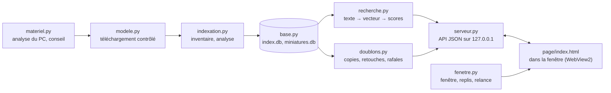

# Architecture de MyPhotos

Ce document décrit le fonctionnement interne de MyPhotos 0.3.0 : les modules, le chemin d'une photo depuis l'analyse du PC jusqu'à la recherche et aux doublons, et les choix techniques avec les mesures qui les justifient. Les mesures datent des 23 et 24/11/2026 ; sauf mention contraire, elles ont été faites sur un Ryzen 5 5600X (6 cœurs) avec une Radeon RX 6600 XT (8 Go) et 32 Go de mémoire vive.

## Vue d'ensemble

MyPhotos est un seul processus Python. Il sert une page web sur `127.0.0.1` et l'affiche dans sa propre fenêtre (pywebview et WebView2, depuis la 0.3.0 ; à défaut Edge en mode application, puis le navigateur) ; la page dialogue avec le processus par une petite API JSON. Tout le calcul (reconnaissance des photos, recherche) a lieu dans ce processus, avec ONNX Runtime, sur la carte graphique par DirectML ou sur le processeur.

| Module | Rôle |
|---|---|
| `myphotos/config.py` | version, port (7796), emplacement des données, formats lus, taille minimale d'une photo (96 px) |
| `myphotos/materiel.py` | description du PC et conseil du moteur ; durée prévue de l'analyse |
| `myphotos/modele.py` | catalogue des quatre moteurs, téléchargement et vérification, prétraitement des images, découpage du texte, sessions ONNX Runtime |
| `myphotos/indexation.py` | inventaire des dossiers suivis, analyse des photos en arrière-plan |
| `myphotos/base.py` | index SQLite, miniatures |
| `myphotos/recherche.py` | recherche par mots, probabilité calibrée, seuils |
| `myphotos/doublons.py` | doublons : copies identiques, copies retouchées, rafales ; empreintes et vérifications gardées dans `index.db` |
| `myphotos/serveur.py` | serveur HTTP local, API, assistant de premier lancement, téléchargements, réglages, copie, Corbeille, recherche des doublons en arrière-plan, arrêt |
| `myphotos/fenetre.py` | la fenêtre de MyPhotos (pywebview, WebView2 par pythonnet), ses réglages durcis, ses replis (Edge en mode application, navigateur), la relance, la fermeture, la place de la fenêtre, le mutex |
| `myphotos/raccourci.py` | raccourcis `.lnk` du Bureau et du menu Démarrer (MyPhotos.exe seul), par COM `IShellLinkW` |
| `myphotos/dialogue.py` | fenêtre « Choisir un dossier » de Windows dans les replis (Edge, navigateur), par COM `IFileOpenDialog` (0.4.0) |
| `myphotos/__main__.py`, `lancer.py` | points d'entrée (`python -m myphotos`, MyPhotos.exe) |
| `page/index.html` | toute l'interface : assistant, recherche, sélection, visionneuse, écran « Doublons », réglages ; HTML, CSS et JavaScript dans un seul fichier, sans ressource externe |

## Le flux : matériel → moteur → analyse → recherche

### 1. Matériel (`materiel.py`)

`analyser()` décrit l'ordinateur en moins de 2 secondes, sans droits d'administrateur, sans WMI et sans charger de modèle : version réelle de Windows (`RtlGetVersion`), processeur, mémoire vive, cartes graphiques (DXGI, avec un essai de Direct3D 12 au niveau 11_0 exigé par DirectML, sans créer de périphérique), présence de DirectML, place libre sur le disque des données, alimentation.

`recommander()` en déduit le moteur, sa variante, le matériel de calcul et la durée prévue de l'analyse :

- carte graphique DirectX 12 dédiée d'au moins 6 Go et 16 Go de mémoire vive : **Précis**, si l'analyse des photos prend moins de 30 minutes (10 000 photos supposées quand on ne sait pas encore combien il y en a), sinon **Standard** ;
- autre carte utilisable (petite carte, puce intégrée récente) : **Standard** ;
- pas de carte utilisable : **Standard** avec au moins 6 cœurs et 8 Go de mémoire vive, sinon **Rapide** ;
- **Très précis** n'est jamais conseillé d'office (+0,7 point de rappel sur Précis pour un téléchargement de 2,1 Go, au lieu de 1,7 Go).

Le conseil vérifie ensuite la mémoire (pic mesuré du moteur, plus une marge pour Windows et le navigateur) et la place sur le disque (moteur, plus 50 Ko par photo, plus 0,5 Go de marge). Au premier lancement, le nombre de photos est estimé en comptant, sans les ouvrir, les fichiers des dossiers proposés, pendant 4 secondes au plus par dossier. Après le téléchargement, `mesurer()` chronomètre le vrai moteur sur des images synthétiques (le premier lot, pendant lequel DirectML compile ses calculs, n'est pas compté) et `estimer_duree()` refait le calcul.

Les vitesses des autres matériels sont extrapolées prudemment à partir des mesures de référence.

### 2. Moteur (`modele.py`)

Les quatre moteurs sont des modèles **SigLIP 2** de Google (Apache-2.0) dans les exports ONNX d'onnx-community. Chacun a deux moitiés : la **vision** transforme une photo en vecteur, le **texte** transforme une requête en vecteur du même espace.

| Moteur | Modèle d'origine | Image | Vecteur | Téléchargement (fp16) |
|---|---|---|---|---|
| Rapide (`rapide`) | siglip2-base-patch32-256 | 256 px | 768 | 788 599 532 octets |
| Standard (`base`) | siglip2-base-patch16-224 | 224 px | 768 | 785 264 785 octets |
| Précis (`precis`) | siglip2-large-patch16-256 | 256 px | 1 024 | 1 798 443 748 octets |
| Très précis (`tres_precis`) | siglip2-so400m-patch16-256 | 256 px | 1 152 | 2 306 857 284 octets |

**Téléchargement.** Chaque entrée du catalogue (`MODELES_DISPO`) fige le dépôt Hugging Face, la révision (empreinte de commit) et, pour chaque fichier, sa taille et son empreinte SHA-256. Trois fichiers sont téléchargés : `tokenizer.json`, `onnx/vision_model_fp16.onnx` et `onnx/text_model_fp16.onnx`. Le téléchargement passe par `urllib` en HTTPS ; un fichier interrompu reprend où il en était (fichier `.part`, requête `Range`) ; un fichier dont l'empreinte ne correspond pas est refait. La place libre est vérifiée avant de commencer. Un téléchargement interrompu par l'arrêt de MyPhotos reprend tout seul au lancement suivant. Sans Internet, un dossier `modele` posé à côté de l'exécutable est recopié, avec les mêmes contrôles de taille et d'empreinte.

**Prétraitement.** `ouvrir_image()` remet la photo dans le bon sens (EXIF) et la convertit en RVB, sur fond blanc pour les images transparentes. Pour un JPEG, Pillow ne décode qu'une version réduite (`draft`) dont le petit côté reste d'au moins 448 px : 4,5 fois plus rapide, pour des vecteurs identiques à 0,9998 près. `pixels()` reproduit exactement le prétraitement de SigLIP (redimensionnement bilinéaire sans recadrage, valeurs ramenées de [0, 255] à [-1, 1]) ; l'écart avec la bibliothèque `transformers` est nul.

**Texte.** La requête est mise en minuscules, découpée par `tokenizers`, terminée par le jeton de fin et complétée jusqu'à 64 jetons.

**Calcul.** `Moteur` ouvre une session ONNX Runtime par moitié. Il essaie d'abord DirectML (carte 0), puis se replie sur le processeur si la carte refuse. Le moteur de texte est chargé à la première recherche, et un préchauffage le charge dès l'activation du moteur, pour que la première vraie recherche soit rapide. Une recherche coûte environ 11 ms sur la carte graphique et 90 ms sur le processeur (moteur Standard).

### 3. Analyse (`indexation.py`)

**Inventaire.** L'indexeur parcourt les dossiers suivis sans suivre les liens symboliques ni les jonctions, et en ignorant la corbeille et les dossiers système. Il repère les photos nouvelles, modifiées (taille ou date de modification à la nanoseconde) et disparues. Un dossier injoignable (disque débranché, partage réseau éteint) garde ses photos dans l'index. L'inventaire a lieu au démarrage, toutes les heures tant que MyPhotos tourne, et à la demande : bouton « Actualiser » (en haut des photos et dans les Réglages).

**Actualiser.** Chaque demande d'inventaire porte un numéro (`Indexeur.relancer()` le renvoie). Quand un inventaire complet se termine, l'indexeur retient le numéro qu'il satisfait et son bilan : photos nouvelles, photos retirées, dossiers injoignables (une photo déplacée ou renommée n'est ni nouvelle ni retirée). `Application.actualiser()` lève une pause éventuelle, demande un inventaire de tous les dossiers et suit ce numéro ; `/api/etat` donne `actualisation` (`en_cours`, puis le bilan et une phrase : « Actualisation terminée : 3 nouvelles photos, 5 012 photos retirées. »). Un second clic pendant un tour ne relance rien. La recherche n'est jamais bloquée : l'inventaire tourne dans le fil de l'indexeur, et la base est en WAL.

**Sous-dossiers exclus.** Un dossier suivi peut avoir des sous-dossiers exclus (table `exclusions`) : `Parcours` ne les parcourt pas, et `Base.ajouter_photos` refuse leurs photos (cas d'une exclusion posée pendant un inventaire). Exclure oublie aussitôt les photos connues dessous (fiches, miniatures, empreintes des doublons) sans toucher au disque ; « Ne plus exclure » demande un inventaire de ce dossier seulement (`relancer(dossiers=[id])`). Les chemins se comparent comme partout : `normaliser_chemin`, `casse_reelle`, puis `cle_chemin` (« Vacances. » n'est pas « Vacances »). Le choix doit être DANS le dossier suivi, et une exclusion qui en contient d'autres les remplace. Un dossier suivi ne peut jamais se trouver dans un sous-dossier exclu : l'ajouter est refusé, avec un message qui dit de choisir d'abord « Ne plus exclure ». Si l'on ajoute un dossier qui contient un dossier suivi, celui-ci est absorbé et garde ses exclusions ; retirer un dossier efface ses exclusions.

**Assistant.** Avant d'ajouter un dossier (premier lancement ou « Ajouter un dossier… »), `indexation.examiner_dossier` compte ses photos sans en ouvrir aucune, en 4 secondes au plus (comme l'estimation du premier lancement). Il renvoie ses 12 plus gros sous-dossiers, ainsi que les dossiers de captures d'écran ou de fonds d'écran trouvés jusqu'à 3 niveaux sous lui. Ces derniers sont reconnus à leur nom par `nature_sous_dossier` : sans accents, sans majuscules, apostrophes droites ou typographiques confondues. Les noms retenus sont « Screenshots » (affiché « Captures d'écran » par Windows), « Captures d'écran », « Captures » (Xbox Game Bar), « Wallpapers », « Fonds d'écran », « Bing Wallpaper », « Windows Spotlight », « Arrière-plans »… La page les présente décochés d'office, avec la raison ; tout le reste est coché. Les sous-dossiers décochés deviennent des exclusions, posées avant le premier inventaire.

**Photo introuvable.** Quand la page ouvre une photo (visionneuse, Ouvrir, Afficher dans le dossier, Copier) dont le fichier manque, `Application.photo_partie` vérifie deux choses : le fichier est introuvable (`FileNotFoundError`, et non un accès refusé ou une erreur réseau), et le dossier suivi répond et n'est pas vide (un partage réseau monté sans son disque paraît vide). Si c'est le cas, la photo est oubliée tout de suite (réponse 410 : « Cette photo n'existe plus sur le disque : MyPhotos l'a retirée. »). Sinon, rien n'est oublié, et le message reste celui du disque débranché (404).

**Analyse.** Pour chaque photo : miniature de 360 px (JPEG qualité 80), date de prise de vue (EXIF, sinon date du fichier), position GPS éventuelle, dimensions et vecteur. Les photos les plus récentes passent en premier. Les images sont décodées à l'avance par plusieurs fils (48 d'avance) pendant que le moteur traite des lots de 16 ; les résultats sont écrits par paquets de 64 photos ou toutes les 2 secondes. Une analyse interrompue reprend où elle en était ; une pause enregistre d'abord ce qui est prêt. Les photos ne sont jamais modifiées, seulement lues ; une image de moins de 96 px de côté est notée « trop petite » et ignorée.

Au changement de moteur, l'ancien moteur est libéré entièrement avant le chargement du nouveau, puis toutes les photos sont analysées de nouveau.

### 4. Index (`base.py`)

SQLite en mode WAL, avec une connexion par fil. Deux fichiers :

- `index.db` : réglages, dossiers suivis, sous-dossiers exclus (table `exclusions`, 0.3.0), photos (taille, date de modification, date de prise de vue, dimensions, latitude et longitude, vecteur, clé du moteur qui l'a calculé, erreur éventuelle) ;
- `miniatures.db` : les miniatures JPEG, rattachées à chaque connexion sous le nom `mini`.

La table `exclusions` (0.3.0) est une table à part, créée à l'ouverture si elle manque : une base 0.2.0 est reprise sans rien perdre, sans changer `user_version`, et une 0.2.0 rouverte sur une base 0.3.0 l'ignore simplement. Oublier des photos (inventaire, exclusion, photo introuvable, dossier retiré) efface aussi leurs miniatures et leurs empreintes de doublons, dans la même transaction.

Le vecteur est enregistré en float16, normalisé. Les écritures passent une à une (verrou) dans des transactions groupées ; grâce au WAL, les lectures de la recherche et des miniatures ne sont jamais bloquées par l'analyse. Les chemins longs et inhabituels de Windows passent par le préfixe `\\?\`. Une photo occupe environ 35 Ko (miniature, fiche et vecteur) ; les estimations comptent 50 Ko, par prudence.

### 5. Recherche (`recherche.py`)

La requête est normalisée (Unicode NFC, espaces réduits, 200 caractères au plus), puis transformée en vecteur ; les 64 derniers vecteurs de requêtes restent en mémoire. Les vecteurs de toutes les photos analysées forment une matrice gardée en mémoire et rechargée au plus une fois par seconde pendant l'analyse ; un seul produit matriciel donne le cosinus de chaque photo avec la requête.

Le cosinus devient une **probabilité calibrée** par le modèle lui-même : `sigmoïde(cosinus × échelle + biais)`, où l'échelle (`exp(logit_scale)`) et le biais (`logit_bias`) sont ceux du modèle d'origine de Google, lus dans ses poids. Deux seuils par moteur trient le résultat :

| Moteur | « sûres » à partir de | « moins sûres » à partir de |
|---|---:|---:|
| Rapide | 0,0005 | 0,0001 |
| Standard | 0,0008 | 0,0002 |
| Précis | 0,0005 | 0,00015 |
| Très précis | 0,0006 | 0,00015 |

Les photos sûres sont triées par score, puis viennent les moins sûres. Quand il y en a peu (moins de 10 sûres), la page propose « Voir les photos les plus proches » : la suite du classement, sous les seuils, par pages de 60 (`proches=1`). Sans requête, la page affiche toutes les photos par date de prise de vue décroissante.

### 6. Serveur et page (`serveur.py`, `page/index.html`)

Le serveur HTTP de la bibliothèque standard, en fils parallèles, écoute uniquement sur `127.0.0.1:7796`. Il n'y a qu'une instance : si le port est déjà pris par MyPhotos, un nouveau lancement ramène sa fenêtre au premier plan (ou ouvre sa page, pour une 0.1.0 ou une 0.2.0) et s'arrête. La page interroge `/api/etat` toutes les 2 secondes (toutes les 30 secondes quand elle est cachée). Dans la fenêtre, fermer la fenêtre arrête MyPhotos ; dans le navigateur, sans aucune requête pendant 3 minutes, le serveur s'arrête proprement : il termine le lot d'analyse en cours et ferme les bases. `POST /api/quitter` (bouton « Arrêter MyPhotos ») fait la même chose sur demande.

La fenêtre « Choisissez un dossier de photos » est celle de Windows. Dans la fenêtre de MyPhotos, elle est ouverte par Windows Forms sur le fil de la fenêtre et lui appartient (elle la bloque tant qu'elle est ouverte) ; dans les replis (Edge, navigateur), c'est la même boîte de dialogue de Windows (`IFileOpenDialog`, `FOS_PICKFOLDERS` et `FOS_FORCEFILESYSTEM`), appelée par COM avec ctypes (`dialogue.py`) dans un fil COM STA qui lui est réservé : elle appartient à une petite fenêtre hôte invisible de MyPhotos, toujours au-dessus et mise au premier plan, posée pour qu'elle s'ouvre au milieu de la fenêtre d'Edge (ou de l'écran). La fenêtre d'Edge, d'un autre processus, n'en est jamais la propriétaire. Depuis la 0.4.0, tkinter et Tcl/Tk ne sont plus embarqués. « Ouvrir avec la visionneuse Windows » confie la photo à l'application associée ; « Afficher dans le dossier » sélectionne le fichier dans l'Explorateur.

**Sélection, copie, Corbeille.** La sélection de la page est un ensemble d'identifiants, indépendant de l'affichage (défilement infini, miniatures déchargées) ; une petite API JavaScript (`window.MyPhotosSelection`) la partage avec l'écran « Doublons ». Les actions portent sur 2 000 photos au plus par requête :

- **Copier** met les fichiers dans le presse-papiers de Windows (format `CF_HDROP`, effet « copie »), par `ctypes`, dans un fil dédié, avec jusqu'à 5 s de réessais si un autre programme le tient ouvert ;
- **Copier dans un dossier…** demande la destination par la fenêtre de Windows, ouverte par le serveur et non par la page, vérifie la place libre, puis copie en arrière-plan sous un nom provisoire renommé à la fin : jamais d'écrasement (« nom (2).jpg »), dates gardées, annulable, jamais de fichier à moitié écrit. La fenêtre a pu rester ouverte plusieurs minutes : chaque photo est donc vérifiée de nouveau juste avant d'être ouverte, son dossier tenu ouvert ; un dossier dont le nom finit par un point ou une espace est refusé comme destination (Windows le confondrait avec un autre) ;
- **Supprimer** passe par `SHFileOperationW` avec `FOF_ALLOWUNDO` : la Corbeille de Windows, jamais une suppression définitive. Avant : disque fixe exigé, Corbeille active et assez grande pour la photo (`SHQueryRecycleBinW`, registre), fichier inchangé depuis l'analyse (taille et date), aucun lien symbolique ni jonction entre le dossier suivi et le fichier ; `FOF_WANTNUKEWARNING` sert de dernier filet. Le dossier de chaque photo est tenu ouvert, sans partage de suppression, de sa vérification jusqu'après l'appel à Windows, et son emplacement réel (`GetFinalPathNameByHandleW`) doit être celui que dit son chemin : ni lui ni un dossier au-dessus ne peut être remplacé par une jonction entre les deux (NTFS refuse de renommer un dossier au-dessus d'une poignée ouverte). Un chemin que Windows lirait autrement n'est jamais transmis : sans le préfixe `\\?\`, « Vacances. » devient « Vacances », un autre dossier ; MyPhotos prend alors le nom court (8.3) ou refuse. Les photos parties sont ensuite oubliées de l'index et des miniatures.

**Doublons.** La recherche des doublons (`doublons.py`, ci-dessous) tourne dans son propre fil (`myphotos-doublons`), lancé par `POST /api/doublons/lancer` ; un seul calcul à la fois. Elle n'utilise que la base et numpy : ni le moteur de reconnaissance, ni le verrou de la carte graphique, ni aucun verrou de l'application ; la recherche de photos et l'analyse continuent pendant ce temps. Le dernier résultat reste en mémoire avec la génération de l'index (`meta.generation`, qui change à chaque écriture de l'analyse ou suppression) au moment du calcul : quand elle a changé, l'état le dit « périmé » et la page relance le calcul d'elle-même (`auto`), au plus une fois toutes les 30 s pendant l'analyse, jamais après un « Arrêter » de l'utilisateur. En attendant, `GET /api/doublons` retire de chaque groupe les photos parties entre-temps (Corbeille, dossier retiré ou débranché), supprime les groupes de moins de deux photos et, si la photo à garder est partie, désigne la meilleure des autres. Les groupes ne donnent que des identifiants et ce qu'il faut afficher (nom, dossier, taille, définition, date) ; la suppression passe par la route de la Corbeille, avec ses vérifications. La page refuse de mettre à la Corbeille toutes les photos d'un groupe de copies.

**Routes de l'API.**

| Méthode | Route | Rôle |
|---|---|---|
| GET | `/api/etat` | état général, interrogé toutes les 2 s : moteur, téléchargement, analyse, photos, copie en cours, `doublons` (avancement, numéro du dernier résultat, périmé ou non) |
| GET | `/api/materiel`, `/api/dossiers` | description du PC et conseil ; dossiers suivis et proposés |
| GET | `/api/photos`, `/api/recherche?q=…` | photos par date ; recherche (`proches=1` : les photos les plus proches) |
| GET | `/api/photo/<id>`, `/miniature/<id>`, `/photo/<id>` | fiche, miniature, photo d'origine |
| GET | `/api/copie` | avancement de la copie vers un dossier |
| GET | `/api/doublons?depuis=<n>` | avancement et dernier résultat ; les groupes sont omis si la page a déjà le résultat `n` |
| POST | `/api/moteur/telecharger`, `/api/moteur/annuler`, `/api/moteur/choisir` | téléchargement et choix du moteur |
| POST | `/api/dossiers/choisir`, `/api/dossiers/ajouter`, `/api/dossiers/retirer` | dossiers suivis (`choisir {examiner: true}` : le dossier choisi est renvoyé sans être ajouté ; `ajouter {chemin, exclus}` : sous-dossiers décochés dans l'assistant) |
| POST | `/api/dossiers/examiner` | assistant : plus gros sous-dossiers et leur nombre de photos, captures et fonds d'écran décochés (`{chemin}`) |
| POST | `/api/exclusions/choisir`, `/api/exclusions/ajouter`, `/api/exclusions/retirer` | exclure un sous-dossier (fenêtre « Choisir un dossier » ouverte dans le dossier suivi, `{dossier}` ; ou `{dossier, chemin}`), ne plus l'exclure (`{id}`) |
| POST | `/api/actualiser` | refaire tout de suite le tour de tous les dossiers (`{deja: true}` si un tour est en cours) ; suivi dans `/api/etat`, champ `actualisation` |
| POST | `/api/photo/verifier` | la photo d'origine ne s'affiche pas : `presente`, `retiree` (oubliée à l'instant), `injoignable` ou `inconnue` (`{id}`) |
| POST | `/api/analyse/pause`, `/api/analyse/reprendre`, `/api/analyse/relancer` | analyse |
| POST | `/api/ouvrir`, `/api/montrer` | ouvrir une photo, la montrer dans l'Explorateur (`{id}`) |
| POST | `/api/copier`, `/api/copier-vers` | presse-papiers, copie vers un dossier (`{ids}`) |
| POST | `/api/copie/annuler`, `/api/copie/montrer` | annuler la copie, ouvrir son dossier |
| POST | `/api/supprimer` | Corbeille (`{ids, confirme: true}`) |
| POST | `/api/doublons/lancer`, `/api/doublons/annuler` | recherche des doublons (`{auto: true}` : relance demandée par la page) |
| POST | `/api/base-ecartee/vu`, `/api/assistant`, `/api/quitter` | avertissement lu, étape de l'assistant, arrêt |

**Sécurité.** N'importe quel site ouvert dans le navigateur peut viser `127.0.0.1` ; d'où :

- en-tête `Host` obligatoire (`127.0.0.1:PORT` ou `localhost:PORT`), contre le « DNS rebinding » ;
- requêtes POST acceptées seulement avec l'en-tête `X-MyPhotos: 1`, qu'un autre site ne peut pas poser sans autorisation CORS (jamais donnée), un corps JSON de 64 Ko au plus et une origine identique à celle du serveur quand elle est présente ;
- requêtes GET refusées quand `Sec-Fetch-Site` désigne un autre site, sauf l'ouverture de la page dans un onglet (`Sec-Fetch-Mode: navigate`, `Sec-Fetch-Dest: document`) : un autre site ne lit rien, ne charge pas la page en douce (fetch « no-cors », cadre) et ne garde donc pas MyPhotos éveillé ;
- requêtes malformées (plus de 20 paramètres, JSON trop imbriqué, hôte illisible) refusées simplement, sans trace d'erreur dans le journal ; erreurs du protocole (méthode inconnue, demande préalable CORS) en JSON, avec les mêmes en-têtes ; le journal ne contient jamais ce que l'utilisateur cherche ;
- politique de sécurité du contenu stricte (nonce, aucune ressource externe), `nosniff`, `no-referrer`, `no-store` sur l'API ;
- photos servies, ouvertes, montrées, copiées ou mises à la Corbeille uniquement par un identifiant présent dans l'index, et seulement si leur extension est celle d'une image : aucun chemin de fichier n'est lu dans l'URL ni dans le corps d'une requête (la destination d'une copie vient de la fenêtre « Choisir un dossier », ouverte par le serveur) ;
- chemins confiés à Windows (Explorateur, presse-papiers, Corbeille, « Ouvrir ») : jamais un chemin qu'il comprendrait autrement ; dossiers tenus ouverts pendant une mise à la Corbeille ou l'ouverture d'une photo à copier (voir « Supprimer » ci-dessus).

### La fenêtre (`fenetre.py`, 0.3.0)

`serveur.main()` crée d'abord le mutex de l'installateur, puis le serveur ; en mode fenêtre, le serveur tourne dans un fil et pywebview 6.2.1 occupe le fil principal. pywebview crée une fenêtre Windows Forms qui contient WebView2 (le moteur d'Edge fourni par Windows), piloté par pythonnet et le .NET Framework. La page est la même, servie par le même serveur, avec les mêmes contrôles HTTP.

- **Avant de créer la fenêtre**, MyPhotos vérifie le .NET Framework (4.7.2 au moins), la clé d'installation de WebView2 et sa version (`GetAvailableCoreWebView2BrowserVersionString` du chargeur embarqué) ; un fichier `MyPhotos.exe.config` posé à côté de l'exécutable, qui pourrait faire charger du code dans le runtime .NET, fait passer directement au repli. Les variables d'environnement du runtime .NET (`COMPLUS_*`, `COR_*`, `DOTNET_*`, `PYTHONNET_*`…) sont retirées, ainsi que `WEBVIEW2_*` hors débogage.
- **Réglages durcis** de WebView2 : outils de développement, raccourcis du navigateur, zoom, barre d'état, saisie automatique, objets hôtes et messages web coupés ; aucun pont JavaScript (`window.pywebview` n'existe pas) ; le filtre de requêtes de pywebview est retiré (il faisait passer chaque miniature par Python) ; menu contextuel réduit à Couper, Copier, Coller, Annuler, Rétablir et Tout sélectionner ; téléchargements, dépôts de fichiers et autorisations refusés.
- **Navigation** : la fenêtre ne quitte jamais la page de MyPhotos (`http://127.0.0.1:<port>/`). Un lien `https` ouvert par l'utilisateur part dans le navigateur par défaut ; `file:`, `data:`, `javascript:`, les autres ports et tout le reste sont bloqués.
- **Données** : le profil WebView2 est en mode privé dans `webview2\` (sous-dossier dédié des données), effacé à la fermeture et au lancement suivant s'il en reste. La place et la taille de la fenêtre vont dans `fenetre.json` (écran disparu : écran principal ; autre DPI : taille mise à l'échelle). DPI « par écran » ; fenêtre agrandie rétablie après son affichage.
- **Relance** : une deuxième instance trouve le port pris, lit `/api/etat` (version, mode, empreinte du compte Windows), puis signale l'événement nommé `Local\MyPhotos-premier-plan-<port>` : la première ramène sa fenêtre au premier plan. Elle relit l'état une seconde plus tard ; si la première était en train de s'arrêter, elle attend le port et démarre à sa place (mesuré : 10 relances sur 10 juste après une fermeture). Une MyPhotos d'un autre compte Windows n'est pas ouverte.
- **Fermeture** : si un travail est en cours (analyse, copie, doublons, téléchargement), une question demande confirmation. Ensuite : arrêt de l'application, du serveur et des bases, puis code de sortie 0. Filet de sécurité : les processus WebView2 enfants directs encore vivants sont arrêtés, après vérification par leur handle (parent, date de création, nom de l'image).
- **Replis** : si WebView2 manque, échoue ou ne répond pas en 30 s, MyPhotos ouvre Microsoft Edge en mode application (`--app`, profil `edge\` à part, `--disable-sync`) ; la fin d'Edge arrête MyPhotos. Sans Edge, la page s'ouvre dans le navigateur par défaut, avec l'arrêt après 3 minutes sans page. `MYPHOTOS_NAVIGATEUR=1` (ou `--navigateur`) force ce dernier mode.
- **Essais** : `MYPHOTOS_DEBUG=1` ouvre les outils de développement depuis les sources ; MyPhotos.exe exige en plus l'option `--essai-debogage`, et le port de débogage (`WEBVIEW2_ADDITIONAL_BROWSER_ARGUMENTS`) n'est jamais ouvert autrement.

Mesures (MyPhotos.exe, base existante) : page affichée 2,2 à 2,7 s après le lancement, fermeture en 1,5 à 2,2 s sans processus restant. WebView2 occupe environ 170 Mo de mémoire privée (6 processus), contre près de 500 Mo pour Edge en mode application.

### 7. Doublons (`doublons.py`)

Trois niveaux de groupes : **copies identiques** (même contenu de fichier), **copies retouchées** (la même photo réduite, recompressée, légèrement recadrée ou redressée, convertie, sans EXIF, avec une bordure, plus claire ou plus sombre) et **photos très proches** (rafales : plusieurs prises du même instant). Les photos ne sont pas relues, sauf pour comparer octet par octet deux fichiers de même taille :

1. **Empreinte** : une empreinte perceptuelle de 64 bits (pHash) par miniature, et le contraste de l'image, gardés dans `index.db` (table `doublons_empreintes`) et refaits seulement si la photo change ;
2. **Identiques** : SHA-256 des fichiers de même taille en octets, seulement si leurs miniatures se ressemblent (quand elles en ont : une photo pas encore analysée n'est comparée qu'ainsi) ;
3. **Paires candidates**, par produits de matrices par blocs : empreintes à au plus 12 bits l'une de l'autre, ou vecteurs du moteur voisins (cosinus d'au moins 0,86) avec des empreintes à au plus 26 bits et des dates de prise de vue compatibles (30 min) ; au plus les 12 plus ressemblantes de chaque photo ;
4. **Vérification** de chaque paire sur les deux miniatures à 128 px : recherche grossière, puis méthode de Lucas et Kanade sur 3 niveaux (échelle, rotation, décalage, lumière). « Retouchée » si l'une tient tout entière dans l'autre et qu'aucun bloc (8 × 8) ne diffère ; « proche » si elles se superposent en grande partie (corrélation d'au moins 0,93 sur 60 % de la surface) ou si les vecteurs sont très voisins (cosinus d'au moins 0,96). Chaque vérification est gardée (table `doublons_paires`) ;
5. **Regroupement** : identiques, puis retouchées (de proche en proche), puis séries de proches autour de la meilleure photo, sans chaîne sans fin.

La photo à garder est la plus grande ; à définition égale, celle qui n'est pas une copie évidente (« copie », « copy », WhatsApp, « (2) »…), puis le fichier le plus lourd, puis la prise de vue la plus ancienne. Les autres sont proposées à la Corbeille, sauf dans les rafales. Les photos illisibles ou d'un dossier injoignable sont écartées (jamais proposer la seule copie joignable) ; les images presque unies ne sont comparées qu'à l'identique.

Les seuils ont été mesurés sur 340 images publiques de Wikimedia Commons et leurs retouches (`outils/calibrer_doublons.py`) : 0 photo différente réunie comme retouche sur 1,4 million de paires, 99,6 % des retouches trouvées. Premier calcul : 41 s pour 10 000 photos et 4 min 13 s pour 50 000, sur une photothèque riche en rafales (la vérification des paires domine) ; relance : 1,2 s et 15 s. Détails et limites : [outils/DOUBLONS.md](../outils/DOUBLONS.md).

## Choix techniques et mesures

### SigLIP 2

Famille retenue pour son compromis entre la qualité en français, la vitesse et la licence, d'après le banc d'essai multilingue d'Immich sur Crossmodal-3600. Rappel en français : 80,2 % (Rapide), 82,9 % (Standard), 85,0 % (Précis), 85,7 % (Très précis). La licence Apache-2.0 autorise la redistribution et l'usage commercial.

### Demi-précision (fp16)

Les variantes fp16 donnent des vecteurs identiques à ceux de fp32 à 0,99999 près, pour un fichier deux fois plus léger. Sur la carte graphique, fp16 va aussi vite que fp32 ; sur le processeur, la vision est 20 % plus lente, mais le téléchargement est deux fois plus petit. Les variantes int8 ont été écartées : leurs vecteurs sont trop abîmés (fidélité 0,76 en vision, 0,95 en texte).

### `ORT_ENABLE_BASIC` sur le processeur

Avec ONNX Runtime 1.24, l'optimisation complète du graphe (`ORT_ENABLE_ALL`) plante au chargement des modèles fp16 sur le processeur (fusion `SimplifiedLayerNormFusion`). Le niveau `ORT_ENABLE_BASIC` les charge, sans perte et à la même vitesse ; il n'est utilisé que pour fp16 sur processeur, la carte graphique gardant `ORT_ENABLE_ALL`. Dans le même cas, la réserve mémoire d'ONNX Runtime est désactivée (`enable_cpu_mem_arena = False`) : le processeur reconvertit les poids fp16 en fp32 à chaque appel, et la réserve gardait ces copies (moteur de texte Standard : 2,1 Go au lieu de 1,0 Go).

### Réglages de DirectML et verrou de la carte graphique

Sur la carte, les sessions sont créées comme DirectML l'exige : `enable_mem_pattern = False` et exécution séquentielle (`ORT_SEQUENTIAL`). Sur le processeur, le calcul utilise la moitié des cœurs logiques.

Avec ONNX Runtime 1.24 et DirectML, deux calculs simultanés sur la carte graphique (deux fils, deux sessions) font planter le processus sans message (violation d'accès, reproduite le 23/11/2026). Tous les calculs faits sur la carte passent donc par un verrou unique pour tout le processus (`_VERROU_CARTE`). Une recherche (11 ms) attend au plus la fin d'un lot d'analyse.

### Seuils calibrés

Les seuils ont été réglés avec `outils/evaluation.py` sur 306 images publiques étiquetées, réparties en 24 catégories, avec 16 requêtes « absentes » (sans aucune bonne réponse). Le modèle est très prudent : une bonne photo a une probabilité médiane de 0,001 à 0,003 seulement, d'où des seuils très bas ; un seuil de 0,05 n'aurait gardé que 3 à 11 % des bonnes photos.

| Moteur | « Sûres » : précision | « Sûres » : rappel | Avec les « moins sûres » : précision | Avec les « moins sûres » : rappel |
|---|---:|---:|---:|---:|
| Rapide | 93 % | 70 % | 79 % | 87 % |
| Standard | 94 % | 75 % | 82 % | 90 % |
| Précis | 93 % | 68 % | 84 % | 84 % |
| Très précis | 93 % | 70 % | 85 % | 85 % |

La requête est donnée au modèle telle quelle (gabarit `{q}`) : c'est la meilleure formulation en français pour les quatre moteurs ; « une photo de {q} » fait perdre 4 à 5 points de précision moyenne, « photo de {q} » 2 à 5. Les majuscules ne changent rien, le pluriel presque rien (de -0,01 à 0), l'absence d'accents un peu, plutôt en mieux (de +0,02 à +0,06). Une phrase précise trouve ce qu'elle décrit : avec « chien sur la plage », les 12 photos de chiens sur une plage sont toutes « sûres ». Le repli qui montrait quand même les meilleures photos sous le seuil n'apportait rien ; il est désactivé. Détails : [outils/EVALUATION.md](../outils/EVALUATION.md).

### Débits et mémoire

Débit du moteur seul (vision, hors lecture et décodage des photos) :

| Moteur | Carte graphique | Processeur | Mémoire vive du moteur (carte / processeur) | Mémoire de la carte |
|---|---:|---:|---:|---:|
| Rapide | 310 photos/s | 26 photos/s | 1,04 Go / 1,2 Go | 0,79 Go |
| Standard | 92 photos/s | 7 photos/s | 1,04 Go / 1,4 Go | 0,93 Go |
| Précis | 20 photos/s | 1,5 photo/s | 1,71 Go / 3,28 Go | 1,9 Go |
| Très précis | 15 photos/s | 1,3 photo/s | 2,07 Go / 4,12 Go | 2,6 Go |

En pratique, la lecture des fichiers limite souvent l'analyse : un disque dur ordinaire plafonne vers 10 photos par seconde lors d'une première lecture. Les quatre moteurs distinguent correctement chien, voiture, chat et vélo (11 contrôles sur 11).

## L'exécutable

MyPhotos.exe est construit par `construction/construire.py` avec PyInstaller : un seul fichier, sans console, de 49,3 Mo (119 Mo une fois extrait) en 0.3.0. À chaque lancement, il se décompresse dans `%TEMP%\_MEI…` en 0,9 seconde environ ; ce dossier est effacé à l'arrêt. `lancer.py` remplace les sorties standard absentes d'un exécutable sans console avant de démarrer le serveur. Le moteur de reconnaissance n'est jamais embarqué. Le script retire `onnxruntime.dll` (20 Mo : l'interface C d'ONNX Runtime, que le module Python ne charge pas), exclut les modules inutiles à l'exécution (outils d'ONNX Runtime, sympy, protobuf, huggingface_hub, formats AVIF et polices de Pillow…) et vérifie la présence des fichiers indispensables (DirectML, tokenizers, OpenSSL, SQLite, la page, et depuis la 0.3.0 les DLL WebView2, `Python.Runtime.dll`, `ClrLoader.dll` et `_cffi_backend`). Les moteurs de pywebview des autres systèmes, la partie « compilation » de cffi et, depuis la 0.4.0, tkinter et Tcl/Tk sont exclus (mesuré le 25/11/2026, mêmes paquets : 45,9 Mo au lieu de 49,3, 114 Mo extrait au lieu de 119 ; version dossier 113,8 Mo en 96 fichiers au lieu de 119,7 Mo en 101) ; les trois `WebView2Loader.dll` (x64, arm64, x86) restent, car pywebview ajoute leurs dossiers au `PATH`. Détails : [construction/LISEZMOI.md](../construction/LISEZMOI.md) ; licences des composants embarqués : [THIRD_PARTY_NOTICES.md](../THIRD_PARTY_NOTICES.md).

### Version dossier et installateur (0.3.0)

`construire.py --dossier` construit la version « dossier » de PyInstaller (onedir) : la même analyse et le même tri des fichiers, mais `MyPhotos.exe` (6,4 Mo) ne contient que le chargeur et le code Python ; les DLL, les modules compilés et la page sont posés à côté, dans `_internal\` (`sys._MEIPASS`, donc `config.CODE`). En tout, 119,7 Mo en 101 fichiers. Le contrôle de la construction vérifie en plus qu'il n'y a rien d'autre que `MyPhotos.exe` et `_internal\` à la racine.

C'est cette version que pose l'installateur, `MyPhotos-<version>-installation.exe` (39,4 Mo, Inno Setup 6.7.4, `construction/MyPhotos.iss`, compilé par `construire.py --installateur`) : pour l'utilisateur seul, sans droits d'administrateur, dans `%LOCALAPPDATA%\Programs\MyPhotos`, avec un raccourci dans le menu Démarrer, une icône sur le Bureau (cochée d'office) et une entrée dans « Applications installées ». MyPhotos.exe seul et l'archive `.zip` restent publiés.

Démarrage jusqu'à la première réponse de la page, même machine, 6 + 6 lancements alternés : **0,51 s** pour la version dossier (un seul processus, rien à extraire), contre **1,57 s** pour l'exécutable en un seul fichier (deux processus, extraction dans `%TEMP%\_MEI…`). L'arrêt passe de 0,82 à 0,54 s. Installée, MyPhotos montre sa fenêtre WebView2 2,2 s après le lancement, sur une base existante.

**Mutex.** Au tout début de `serveur.main()`, dans tous les modes, MyPhotos crée le mutex nommé `config.MUTEX` (`MyPhotos-25DE0724-F7B4-4956-8238-1E33E16ABFED`, sur le modèle de l'`AppId` de l'installateur) et le garde jusqu'à sa sortie. L'installateur et le désinstallateur le cherchent (`AppMutex`) : tant qu'il existe, ils demandent de fermer MyPhotos ; en silence, ils sortent avec le code 1 sans rien toucher (mesuré : refus en 0,3 s, fichiers inchangés, MyPhotos toujours ouvert). Sans lui, un désinstallateur effaçait les fichiers sous un MyPhotos en marche (constaté avec la 0.2.0). Fermer la fenêtre arrête MyPhotos et libère le mutex (1,2 s après WM_CLOSE, avec WebView2). `AppId` et nom du mutex ne changent jamais ; un essai vérifie qu'`AppMutex` vaut `config.MUTEX`.

**Mise à jour.** Relancé, l'installateur reprend le dossier précédent, retire `_internal\` et `licences\` de l'ancienne version, puis copie la nouvelle ; les données ne bougent pas. Il ne retire ces deux dossiers que dans le dossier d'une installation de MyPhotos (le dossier précédent, ou un dossier qui contient déjà `MyPhotos.exe` et `_internal\`) ; un dossier existant choisi par `/DIR` garde ses propres `licences\` (essai adverse : ils étaient vidés). Il refuse un dossier qui contient le `_internal\` d'un autre programme, et un dossier au chemin trop long (le plus long chemin installé fait 89 caractères, 99 avec le nom provisoire `is-XXXXXXXXXX.tmp` sous lequel Inno Setup copie chaque fichier : au-delà de 259 en tout, la copie échouerait au milieu).

**Désinstallation et garde-fous.** Le désinstallateur retire le programme, les raccourcis créés par l'installateur, et ceux créés depuis les Réglages (`raccourci.py`) s'ils désignent le `MyPhotos.exe` désinstallé. Il propose ensuite de supprimer les données, **Non** par défaut ; en silence, il les garde, sauf avec `/SUPPRIMERDONNEES`. Le dossier proposé est `MYPHOTOS_DOSSIER` ou `%LOCALAPPDATA%\MyPhotos`, et seulement s'il passe tous les garde-fous : chemin complet sans `..`, ni racine de disque, ni dossier de l'utilisateur ou du système (ni l'un de leurs parents), présence d'`index.db` ou du marqueur `myphotos-donnees.txt`, et pas un lien. Seuls les éléments que MyPhotos crée à la racine sont supprimés, par leur nom exact (`NomDeMyPhotos` : `modele\`, `index.db` et `miniatures.db` avec leurs fichiers SQLite et leurs copies `.abimee-…`, `journal.log` et ses copies `.1` et `.2`, `fenetre.json` et `.part`, `webview2\`, `edge\`) ; tout autre fichier est gardé (`Journal.log.txt`, `index.db.sauvegarde`…), et le dossier avec. Les dossiers `modele\`, `webview2\` et `edge\` ne partent que si leur contenu est celui de MyPhotos (`ContenuDeMyPhotos` : fichiers du moteur seulement, `EBWebView\` seulement, profil d'Edge avec son `Local State`) ; des photos rangées là par l'utilisateur restent (essai adverse de la 0.3.0 : elles partaient). Limite connue : les dossiers protégés sont comparés par leur chemin écrit, et un autre chemin vers le même dossier (nom court 8.3, partage `\\localhost\C$`) n'est pas reconnu ; seuls les noms ci-dessus y seraient supprimés. Un lien n'est jamais suivi : une jonction `modele` vers un autre dossier est retirée, sa cible reste intacte (essayé).

## Données

| Fichier | Contenu |
|---|---|
| `index.db` | dossiers suivis et sous-dossiers exclus, fiches des photos, vecteurs, réglages ; empreintes et vérifications des doublons (tables `doublons_*`) |
| `miniatures.db` | miniatures de 360 px |
| `modele/<clé>/` | fichiers des moteurs téléchargés |
| `journal.log` | journal de fonctionnement (rotation automatique) |
| `fenetre.json` | taille et place de la fenêtre de MyPhotos |
| `webview2/` | profil WebView2 de la fenêtre (mode privé : effacé à la fermeture) |
| `edge/` | profil d'Edge en mode application, quand WebView2 manque |

Le désinstallateur ne supprime que ces noms-là (voir plus haut) : tout nouvel élément rangé à la racine des données doit être ajouté à `NomDeMyPhotos` dans `construction/MyPhotos.iss`, ce que `tests/test_construction.py` vérifie sur un vrai serveur d'essai.

Emplacement : `%LOCALAPPDATA%\MyPhotos` pour MyPhotos.exe, `donnees\` depuis les sources, ou le dossier indiqué par `MYPHOTOS_DOSSIER`. Rien n'est jamais écrit à côté des photos, sauf les copies demandées (« Copier dans un dossier… »).

## Essais

292 essais, lancés par `.venv\Scripts\python.exe -m unittest tests.test_coeur tests.test_materiel tests.test_serveur tests.test_verifier_publication tests.test_doublons tests.test_construction tests.test_fenetre` :

- `tests/test_coeur.py` (60) : index, analyse et recherche, avec un moteur factice déterministe et des images générées par Pillow ;
- `tests/test_materiel.py` (30) : description de machines types, règles de conseil, robustesse quand une information manque ;
- `tests/test_serveur.py` (75) : vrai serveur dans un sous-processus, sur un port d'essai, interrogé par de vraies requêtes HTTP : sécurité (dont un autre site qui ne doit ni lire, ni charger la page en douce, ni garder MyPhotos éveillé ; requêtes malformées sans trace dans le journal ; dossier « Vacances. » ; jonction posée pendant une copie ou juste avant une mise à la Corbeille), réponses de l'API, instance unique, actions Windows simulées, choix d'un dossier, sélection (presse-papiers, copie, Corbeille simulés), doublons (routes, protections, calcul en arrière-plan sans moteur ni verrou, relance, suppression depuis un groupe), et un essai de bout en bout sur des images publiques ;
- `tests/test_verifier_publication.py` (30) : le garde-fou de publication ;
- `tests/test_doublons.py` (15) : les trois niveaux de doublons, le choix de la photo à garder, la reprise sans recalcul, l'annulation, sur des images générées ;
- `tests/test_construction.py` (27) : préparation de la publication sans réseau (licences, empreintes, cache, DLL WebView2 comparées au paquet NuGet officiel), version dossier et installateur (voir plus bas) ;
- `tests/test_fenetre.py` (55) : modes et replis, filtre des navigations, menu contextuel, relance (ancienne version, autre compte, instance qui s'arrête), fermeture et question, placement de la fenêtre, filet de sécurité des processus WebView2, mutex, raccourcis ; ses essais réels, à la demande (`MYPHOTOS_ESSAI_FENETRE=1`), ouvrent la vraie fenêtre sur un bureau Windows invisible, tous les processus dans un Job Object, et la pilotent par le protocole DevTools : recherche, Ctrl+A et Échap, liens envoyés au navigateur (simulé), `file:` bloqué, « Choisir un dossier » qui appartient à la fenêtre, relance, question à la fermeture, relance juste après une fermeture.

Actualiser, sous-dossiers exclus, assistant et photo introuvable (0.3.0) sont essayés dans `test_coeur` (classes `TestExclusions`, `TestActualisation` et `TestExamen` : migration d'une base 0.2.0, dossier « Album. ») et dans `test_serveur` (`TestDossiersEtActualiser`). Ils le sont aussi dans un essai réel de la fenêtre (`TestFenetreReelle.test_sous_dossiers_actualiser_et_photo_introuvable`, avec `MYPHOTOS_ESSAI_FENETRE=1`). Cet essai tourne sur un bureau invisible et pilote la page par CDP, sur un dossier d'essai à part : liste à cocher avec « Captures d'écran » décochée, « Actualiser » après la suppression de fichiers d'essai, exclusion puis « Ne plus exclure », refus d'un dossier hors du dossier suivi, puis photo supprimée ouverte dans la visionneuse.

Les vrais appels à Windows (presse-papiers, Corbeille) ne sont essayés qu'à la demande (`MYPHOTOS_ESSAI_WINDOWS=1`).

La version dossier et l'installateur sont essayés dans `tests/test_construction.py` : `.spec` de la version dossier, contrôle de sa racine et de son contenu, options de `construire.py`, règles du `.iss` (AppId, `AppMutex` égal à `config.MUTEX`, `PrivilegesRequired=lowest`, nom du fichier produit, aucune ligne de `[Code]` qui commence par `[`, UTF-8 sans BOM), et `NomDeMyPhotos` relu dans le `.iss` et comparé aux noms que crée un vrai serveur d'essai. L'essai réel, à la demande (`MYPHOTOS_ESSAI_INSTALLATEUR=1`, Inno Setup installé, version dossier construite), compile l'installateur et, dans un dossier d'essai, sur un bureau invisible, tous les processus dans un Job Object : dossier trop long refusé, installation silencieuse sans raccourci, refus pendant que le mutex existe, mise à jour par-dessus, désinstallations sans puis avec `/SUPPRIMERDONNEES`, dossier protégé ; l'entrée de « Applications installées » disparaît à la fin.

Outils :

- `outils/evaluation.py` et `outils/EVALUATION.md` : réglage et mesure des seuils ;
- `outils/banc_essai.py` : vitesse et fidélité des variantes d'un moteur ;
- `outils/calibrer_doublons.py` et `outils/DOUBLONS.md` : réglage et mesure des seuils des doublons ;
- `outils/verifier_publication.py` : aucune donnée personnelle dans le dépôt ;
- `construction/essai_exe.py` : vérification de l'exécutable construit (DirectML, processeur, téléchargement).
Aucun essai n'utilise de photo personnelle : images générées, ou images publiques de Wikimedia Commons.
