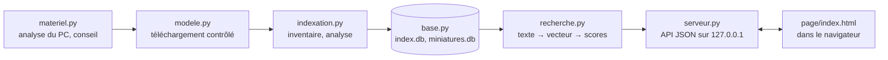

# Architecture de MyPhotos

Ce document décrit le fonctionnement interne de MyPhotos 0.1.0 : les modules, le chemin d'une photo depuis l'analyse du PC jusqu'à la recherche, et les choix techniques avec les mesures qui les justifient. Toutes les mesures datent du 23/11/2026 ; sauf mention contraire, elles ont été faites sur un Ryzen 5 5600X (6 cœurs) avec une Radeon RX 6600 XT (8 Go) et 32 Go de mémoire vive.

## Vue d'ensemble

MyPhotos est un seul processus Python. Il sert une page web sur `127.0.0.1` et ouvre le navigateur sur elle ; la page dialogue avec le processus par une petite API JSON. Tout le calcul (reconnaissance des photos, recherche) a lieu dans ce processus, avec ONNX Runtime, sur la carte graphique par DirectML ou sur le processeur.

| Module | Rôle |
|---|---|
| `myphotos/config.py` | version, port (7796), emplacement des données, formats lus, taille minimale d'une photo (96 px) |
| `myphotos/materiel.py` | description du PC et conseil du moteur ; durée prévue de l'analyse |
| `myphotos/modele.py` | catalogue des quatre moteurs, téléchargement et vérification, prétraitement des images, découpage du texte, sessions ONNX Runtime |
| `myphotos/indexation.py` | inventaire des dossiers suivis, analyse des photos en arrière-plan |
| `myphotos/base.py` | index SQLite, miniatures |
| `myphotos/recherche.py` | recherche par mots, probabilité calibrée, seuils |
| `myphotos/serveur.py` | serveur HTTP local, API, assistant de premier lancement, téléchargements, réglages, arrêt |
| `myphotos/__main__.py`, `lancer.py` | points d'entrée (`python -m myphotos`, MyPhotos.exe) |
| `page/index.html` | toute l'interface : assistant, recherche, visionneuse, réglages ; HTML, CSS et JavaScript dans un seul fichier, sans ressource externe |

## Le flux : matériel → moteur → analyse → recherche

### 1. Matériel (`materiel.py`)

`analyser()` décrit l'ordinateur en moins de 2 secondes, sans droits d'administrateur, sans WMI et sans charger de modèle : version réelle de Windows (`RtlGetVersion`), processeur, mémoire vive, cartes graphiques (DXGI, avec un essai de Direct3D 12 au niveau 11_0 exigé par DirectML, sans créer de périphérique), présence de DirectML, place libre sur le disque des données, alimentation.

`recommander()` en déduit le moteur, sa variante, le matériel de calcul et la durée prévue de l'analyse :

- carte graphique DirectX 12 dédiée d'au moins 6 Go et 16 Go de mémoire vive : **Précis**, si l'analyse des photos prend moins de 30 minutes (10 000 photos supposées quand on ne sait pas encore combien il y en a), sinon **Standard** ;
- autre carte utilisable (petite carte, puce intégrée récente) : **Standard** ;
- pas de carte utilisable : **Standard** avec au moins 6 cœurs et 8 Go de mémoire vive, sinon **Rapide** ;
- **Très précis** n'est jamais conseillé d'office (+0,7 point de rappel sur Précis pour un téléchargement de 2,1 Go, au lieu de 1,7 Go).

Le conseil vérifie ensuite la mémoire (pic mesuré du moteur, plus une marge pour Windows et le navigateur) et la place sur le disque (moteur, plus 50 Ko par photo, plus 0,5 Go de marge). Au premier lancement, le nombre de photos est estimé en comptant, sans les ouvrir, les fichiers des dossiers proposés, pendant 4 secondes au plus par dossier. Après le téléchargement, `mesurer()` chronomètre le vrai moteur sur des images synthétiques (le premier lot, pendant lequel DirectML compile ses calculs, n'est pas compté) et `estimer_duree()` refait le calcul.

Les vitesses des autres matériels sont extrapolées prudemment à partir des mesures de référence.

### 2. Moteur (`modele.py`)

Les quatre moteurs sont des modèles **SigLIP 2** de Google (Apache-2.0) dans les exports ONNX d'onnx-community. Chacun a deux moitiés : la **vision** transforme une photo en vecteur, le **texte** transforme une requête en vecteur du même espace.

| Moteur | Modèle d'origine | Image | Vecteur | Téléchargement (fp16) |
|---|---|---|---|---|
| Rapide (`rapide`) | siglip2-base-patch32-256 | 256 px | 768 | 788 599 532 octets |
| Standard (`base`) | siglip2-base-patch16-224 | 224 px | 768 | 785 264 785 octets |
| Précis (`precis`) | siglip2-large-patch16-256 | 256 px | 1 024 | 1 798 443 748 octets |
| Très précis (`tres_precis`) | siglip2-so400m-patch16-256 | 256 px | 1 152 | 2 306 857 284 octets |

**Téléchargement.** Chaque entrée du catalogue (`MODELES_DISPO`) fige le dépôt Hugging Face, la révision (empreinte de commit) et, pour chaque fichier, sa taille et son empreinte SHA-256. Trois fichiers sont téléchargés : `tokenizer.json`, `onnx/vision_model_fp16.onnx` et `onnx/text_model_fp16.onnx`. Le téléchargement passe par `urllib` en HTTPS ; un fichier interrompu reprend où il en était (fichier `.part`, requête `Range`) ; un fichier dont l'empreinte ne correspond pas est refait. La place libre est vérifiée avant de commencer. Un téléchargement interrompu par l'arrêt de MyPhotos reprend tout seul au lancement suivant. Sans Internet, un dossier `modele` posé à côté de l'exécutable est recopié, avec les mêmes contrôles de taille et d'empreinte.

**Prétraitement.** `ouvrir_image()` remet la photo dans le bon sens (EXIF) et la convertit en RVB, sur fond blanc pour les images transparentes. Pour un JPEG, Pillow ne décode qu'une version réduite (`draft`) dont le petit côté reste d'au moins 448 px : 4,5 fois plus rapide, pour des vecteurs identiques à 0,9998 près. `pixels()` reproduit exactement le prétraitement de SigLIP (redimensionnement bilinéaire sans recadrage, valeurs ramenées de [0, 255] à [-1, 1]) ; l'écart avec la bibliothèque `transformers` est nul.

**Texte.** La requête est mise en minuscules, découpée par `tokenizers`, terminée par le jeton de fin et complétée jusqu'à 64 jetons.

**Calcul.** `Moteur` ouvre une session ONNX Runtime par moitié. Il essaie d'abord DirectML (carte 0), puis se replie sur le processeur si la carte refuse. Le moteur de texte est chargé à la première recherche, et un préchauffage le charge dès l'activation du moteur, pour que la première vraie recherche soit rapide. Une recherche coûte environ 11 ms sur la carte graphique et 90 ms sur le processeur (moteur Standard).

### 3. Analyse (`indexation.py`)

**Inventaire.** L'indexeur parcourt les dossiers suivis sans suivre les liens symboliques ni les jonctions, et en ignorant la corbeille et les dossiers système. Il repère les photos nouvelles, modifiées (taille ou date de modification à la nanoseconde) et disparues. Un dossier injoignable (disque débranché, partage réseau éteint) garde ses photos dans l'index. L'inventaire a lieu au démarrage, à la demande (« Chercher les nouvelles photos maintenant ») et toutes les heures tant que MyPhotos tourne.

**Analyse.** Pour chaque photo : miniature de 360 px (JPEG qualité 80), date de prise de vue (EXIF, sinon date du fichier), position GPS éventuelle, dimensions et vecteur. Les photos les plus récentes passent en premier. Les images sont décodées à l'avance par plusieurs fils (48 d'avance) pendant que le moteur traite des lots de 16 ; les résultats sont écrits par paquets de 64 photos ou toutes les 2 secondes. Une analyse interrompue reprend où elle en était ; une pause enregistre d'abord ce qui est prêt. Les photos ne sont jamais modifiées, seulement lues ; une image de moins de 96 px de côté est notée « trop petite » et ignorée.

Au changement de moteur, l'ancien moteur est libéré entièrement avant le chargement du nouveau, puis toutes les photos sont analysées de nouveau.

### 4. Index (`base.py`)

SQLite en mode WAL, avec une connexion par fil. Deux fichiers :

- `index.db` : réglages, dossiers suivis, photos (taille, date de modification, date de prise de vue, dimensions, latitude et longitude, vecteur, clé du moteur qui l'a calculé, erreur éventuelle) ;
- `miniatures.db` : les miniatures JPEG, rattachées à chaque connexion sous le nom `mini`.

Le vecteur est enregistré en float16, normalisé. Les écritures passent une à une (verrou) dans des transactions groupées ; grâce au WAL, les lectures de la recherche et des miniatures ne sont jamais bloquées par l'analyse. Les chemins longs et inhabituels de Windows passent par le préfixe `\\?\`. Une photo occupe environ 35 Ko (miniature, fiche et vecteur) ; les estimations comptent 50 Ko, par prudence.

### 5. Recherche (`recherche.py`)

La requête est normalisée (Unicode NFC, espaces réduits, 200 caractères au plus), puis transformée en vecteur ; les 64 derniers vecteurs de requêtes restent en mémoire. Les vecteurs de toutes les photos analysées forment une matrice gardée en mémoire et rechargée au plus une fois par seconde pendant l'analyse ; un seul produit matriciel donne le cosinus de chaque photo avec la requête.

Le cosinus devient une **probabilité calibrée** par le modèle lui-même : `sigmoïde(cosinus × échelle + biais)`, où l'échelle (`exp(logit_scale)`) et le biais (`logit_bias`) sont ceux du modèle d'origine de Google, lus dans ses poids. Deux seuils par moteur trient le résultat :

| Moteur | « sûres » à partir de | « moins sûres » à partir de |
|---|---:|---:|
| Rapide | 0,0005 | 0,0001 |
| Standard | 0,0008 | 0,0002 |
| Précis | 0,0005 | 0,00015 |
| Très précis | 0,0006 | 0,00015 |

Les photos sûres sont triées par score, puis viennent les moins sûres. Sans requête, la page affiche toutes les photos par date de prise de vue décroissante.

### 6. Serveur et page (`serveur.py`, `page/index.html`)

Le serveur HTTP de la bibliothèque standard, en fils parallèles, écoute uniquement sur `127.0.0.1:7796`. Il n'y a qu'une instance : si le port est déjà pris par MyPhotos, un nouveau lancement ouvre simplement la page et s'arrête. La page interroge `/api/etat` toutes les 2 secondes (toutes les 30 secondes quand elle est cachée) ; sans aucune requête pendant 3 minutes, le serveur s'arrête proprement : il termine le lot d'analyse en cours et ferme les bases. `POST /api/quitter` (bouton « Arrêter MyPhotos ») fait la même chose sur demande.

La fenêtre « Choisissez un dossier de photos » est celle de Windows, ouverte par tkinter dans un fil qui lui est réservé et ramenée au premier plan. « Ouvrir avec la visionneuse Windows » confie la photo à l'application associée ; « Afficher dans le dossier » sélectionne le fichier dans l'Explorateur.

**Sécurité.** N'importe quel site ouvert dans le navigateur peut viser `127.0.0.1` ; d'où :

- en-tête `Host` obligatoire (`127.0.0.1:PORT` ou `localhost:PORT`), contre le « DNS rebinding » ;
- requêtes POST acceptées seulement avec l'en-tête `X-MyPhotos: 1`, qu'un autre site ne peut pas poser sans autorisation CORS (jamais donnée), un corps JSON de 64 Ko au plus et une origine identique à celle du serveur quand elle est présente ;
- lectures de données (`/api/`, `/miniature/`, `/photo/`) refusées quand `Sec-Fetch-Site` désigne un autre site ;
- politique de sécurité du contenu stricte (nonce, aucune ressource externe), `nosniff`, `no-referrer`, `no-store` sur l'API ;
- photos servies, ouvertes ou montrées uniquement par un identifiant présent dans l'index, et seulement si leur extension est celle d'une image : aucun chemin de fichier n'est lu dans l'URL.

## Choix techniques et mesures

### SigLIP 2

Famille retenue pour son compromis entre la qualité en français, la vitesse et la licence, d'après le banc d'essai multilingue d'Immich sur Crossmodal-3600. Rappel en français : 80,2 % (Rapide), 82,9 % (Standard), 85,0 % (Précis), 85,7 % (Très précis). La licence Apache-2.0 autorise la redistribution et l'usage commercial.

### Demi-précision (fp16)

Les variantes fp16 donnent des vecteurs identiques à ceux de fp32 à 0,99999 près, pour un fichier deux fois plus léger. Sur la carte graphique, fp16 va aussi vite que fp32 ; sur le processeur, la vision est 20 % plus lente, mais le téléchargement est deux fois plus petit. Les variantes int8 ont été écartées : leurs vecteurs sont trop abîmés (fidélité 0,76 en vision, 0,95 en texte).

### `ORT_ENABLE_BASIC` sur le processeur

Avec ONNX Runtime 1.24, l'optimisation complète du graphe (`ORT_ENABLE_ALL`) plante au chargement des modèles fp16 sur le processeur (fusion `SimplifiedLayerNormFusion`). Le niveau `ORT_ENABLE_BASIC` les charge, sans perte et à la même vitesse ; il n'est utilisé que pour fp16 sur processeur, la carte graphique gardant `ORT_ENABLE_ALL`. Dans le même cas, la réserve mémoire d'ONNX Runtime est désactivée (`enable_cpu_mem_arena = False`) : le processeur reconvertit les poids fp16 en fp32 à chaque appel, et la réserve gardait ces copies (moteur de texte Standard : 2,1 Go au lieu de 1,0 Go).

### Réglages de DirectML et verrou de la carte graphique

Sur la carte, les sessions sont créées comme DirectML l'exige : `enable_mem_pattern = False` et exécution séquentielle (`ORT_SEQUENTIAL`). Sur le processeur, le calcul utilise la moitié des cœurs logiques.

Avec ONNX Runtime 1.24 et DirectML, deux calculs simultanés sur la carte graphique (deux fils, deux sessions) font planter le processus sans message (violation d'accès, reproduite le 23/11/2026). Tous les calculs faits sur la carte passent donc par un verrou unique pour tout le processus (`_VERROU_CARTE`). Une recherche (11 ms) attend au plus la fin d'un lot d'analyse.

### Seuils calibrés

Les seuils ont été réglés avec `outils/evaluation.py` sur 306 images publiques étiquetées, réparties en 24 catégories, avec 16 requêtes « absentes » (sans aucune bonne réponse). Le modèle est très prudent : une bonne photo a une probabilité médiane de 0,001 à 0,003 seulement, d'où des seuils très bas ; un seuil de 0,05 n'aurait gardé que 3 à 11 % des bonnes photos.

| Moteur | « Sûres » : précision | « Sûres » : rappel | Avec les « moins sûres » : précision | Avec les « moins sûres » : rappel |
|---|---:|---:|---:|---:|
| Rapide | 93 % | 70 % | 79 % | 87 % |
| Standard | 94 % | 75 % | 82 % | 90 % |
| Précis | 93 % | 68 % | 84 % | 84 % |
| Très précis | 93 % | 70 % | 85 % | 85 % |

La requête est donnée au modèle telle quelle (gabarit `{q}`) : c'est la meilleure formulation en français pour les quatre moteurs ; « une photo de {q} » fait perdre 4 à 5 points de précision moyenne, « photo de {q} » 2 à 5. Les majuscules ne changent rien, le pluriel presque rien (de -0,01 à 0), l'absence d'accents un peu, plutôt en mieux (de +0,02 à +0,06). Une phrase précise trouve ce qu'elle décrit : avec « chien sur la plage », les 12 photos de chiens sur une plage sont toutes « sûres ». Le repli qui montrait quand même les meilleures photos sous le seuil n'apportait rien ; il est désactivé. Détails : [outils/EVALUATION.md](../outils/EVALUATION.md).

### Débits et mémoire

Débit du moteur seul (vision, hors lecture et décodage des photos) :

| Moteur | Carte graphique | Processeur | Mémoire vive du moteur (carte / processeur) | Mémoire de la carte |
|---|---:|---:|---:|---:|
| Rapide | 310 photos/s | 26 photos/s | 1,04 Go / 1,2 Go | 0,79 Go |
| Standard | 92 photos/s | 7 photos/s | 1,04 Go / 1,4 Go | 0,93 Go |
| Précis | 20 photos/s | 1,5 photo/s | 1,71 Go / 3,28 Go | 1,9 Go |
| Très précis | 15 photos/s | 1,3 photo/s | 2,07 Go / 4,12 Go | 2,6 Go |

En pratique, la lecture des fichiers limite souvent l'analyse : un disque dur ordinaire plafonne vers 10 photos par seconde lors d'une première lecture. Les quatre moteurs distinguent correctement chien, voiture, chat et vélo (11 contrôles sur 11).

## L'exécutable

MyPhotos.exe est construit par `construction/construire.py` avec PyInstaller : un seul fichier, sans console, de 47,8 Mo (116 Mo une fois extrait). À chaque lancement, il se décompresse dans `%TEMP%\_MEI…` en 0,9 seconde environ ; ce dossier est effacé à l'arrêt. `lancer.py` remplace les sorties standard absentes d'un exécutable sans console avant de démarrer le serveur. Le moteur de reconnaissance n'est jamais embarqué. Le script retire `onnxruntime.dll` (20 Mo : l'interface C d'ONNX Runtime, que le module Python ne charge pas), exclut les modules inutiles à l'exécution (outils d'ONNX Runtime, sympy, protobuf, huggingface_hub, formats AVIF et polices de Pillow…) et vérifie la présence des fichiers indispensables (DirectML, tokenizers, Tcl/Tk, OpenSSL, SQLite, la page). Détails : [construction/LISEZMOI.md](../construction/LISEZMOI.md) ; licences des composants embarqués : [THIRD_PARTY_NOTICES.md](../THIRD_PARTY_NOTICES.md).

## Données

| Fichier | Contenu |
|---|---|
| `index.db` | dossiers suivis, fiches des photos, vecteurs, réglages |
| `miniatures.db` | miniatures de 360 px |
| `modele/<clé>/` | fichiers des moteurs téléchargés |
| `journal.log` | journal de fonctionnement (rotation automatique) |

Emplacement : `%LOCALAPPDATA%\MyPhotos` pour MyPhotos.exe, `donnees\` depuis les sources, ou le dossier indiqué par `MYPHOTOS_DOSSIER`. Rien n'est jamais écrit à côté des photos.

## Essais

86 essais, lancés par `.venv\Scripts\python.exe -m unittest tests.test_coeur tests.test_materiel tests.test_serveur` :

- `tests/test_coeur.py` (36) : index, analyse et recherche, avec un moteur factice déterministe et des images générées par Pillow ;
- `tests/test_materiel.py` (27) : description de machines types, règles de conseil, robustesse quand une information manque ;
- `tests/test_serveur.py` (23) : vrai serveur dans un sous-processus, sur un port d'essai, interrogé par de vraies requêtes HTTP : sécurité, réponses de l'API, instance unique, actions Windows simulées, choix d'un dossier, et un essai de bout en bout sur des images publiques.

Outils :

- `outils/evaluation.py` et `outils/EVALUATION.md` : réglage et mesure des seuils ;
- `outils/banc_essai.py` : vitesse et fidélité des variantes d'un moteur ;
- `construction/essai_exe.py` : vérification de l'exécutable construit (DirectML, processeur, téléchargement).
Aucun essai n'utilise de photo personnelle : images générées, ou images publiques de Wikimedia Commons.
